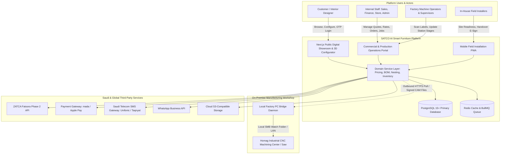
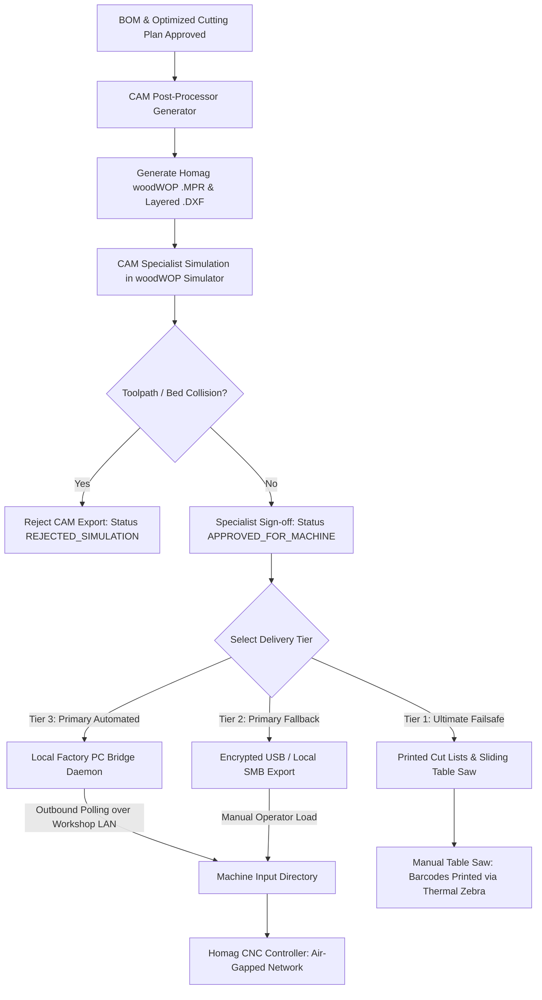
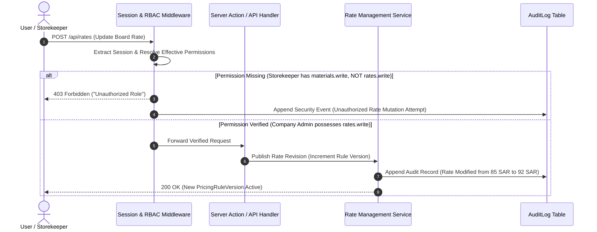
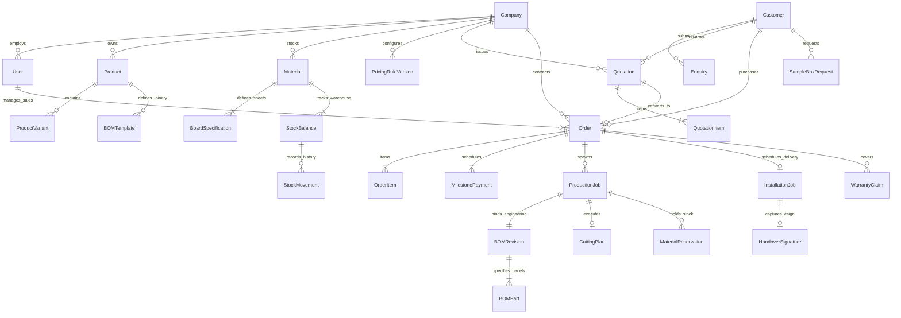
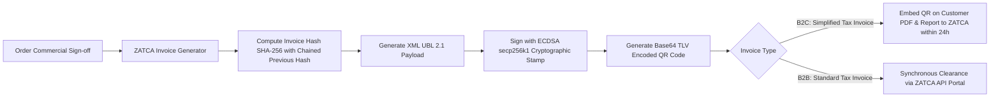

# SATCO AI Smart Furniture Platform
## System Architecture & Technical Design Document

**Document Title:** Software Architecture Document (SAD)  
**Target Path:** `Architecture.md`  
**System Name:** SATCO AI Smart Furniture Platform  
**Target Market:** Kingdom of Saudi Arabia (Riyadh, Jeddah, Dammam)  
**Version:** 1.0 (Production Blueprint Baseline)  
**Date:** November 2026  
**Status:** Approved for Development  
**Author:** Lead Enterprise Solution Architect & Principal Systems Engineer  

---

## Executive Summary & System Philosophy

The **SATCO AI Smart Furniture Platform** is an enterprise-grade digital manufacturing and commercial platform engineered specifically for the custom cabinetry, modular wardrobe, and smart furniture manufacturing industry in Saudi Arabia.

Unlike conventional off-the-shelf e-commerce software, custom furniture manufacturing involves a **physical irreversibility constraint**:
$$\text{Raw Sheet Stock } (2440 \times 1220\text{ mm}) \xrightarrow[\text{Homag CNC}]{\text{Saw Blade Cut}} \text{Custom Panels } (1842 \times 564\text{ mm})$$
Once engineered panels are cut, edge-banded, and bored for joinery hardware, they cannot be returned to raw inventory. Unverified specifications, invalid structural spans, uncollected deposits, or machine CAM incompatibilities cause catastrophic physical scrap overhead and financial losses.

### Core Architectural Mandates:
1. **Strict Decoupling of Visuals from Fabrication:** Customer-facing 3D meshes, WebXR Augmented Reality (AR), and Generative AI room concepts are aesthetic approximations. Manufacturing data (BOM, 2D nesting cutting lists, and Homag CNC machine code) is derived strictly from backend parametric joinery formulas.
2. **Deterministic Financial & Dimensional Precision:** Zero floating-point representation (`Prisma.Decimal` / `NUMERIC(12, 4)`); all spatial dimensions normalized to integer millimeters ($mm$).
3. **Air-Gapped CNC Protection & 3-Tier Fallback:** Machine controllers are isolated on a local workshop LAN with zero public internet exposure, protected by a hierarchical fallback (Automated Factory PC Bridge $\to$ Manual Encrypted USB $\to$ Paper Cutting List Travelers & Barcodes).
4. **Saudi Localization & Regulatory Compliance:** Full compliance with ZATCA Phase 2 e-Invoicing (cryptographic TLV QR codes), Saudi Personal Data Protection Law (PDPL - shop-floor PII redaction), and bilingual LTR/RTL Next.js App Router interfaces.

---

## 1. High-Level Architecture (HLA)

The SATCO platform is designed as a **Hexagonal Modular Monolith** with Domain-Driven Design (DDD) tactical boundaries. This ensures high cohesion within business domains, low coupling across domains, ACID transactional integrity on critical order/inventory mutations, and seamless operational deployment without premature microservice network overhead.

### 1.1 C4 Context Diagram (System Ecosystem)



### 1.2 Container Architecture & Tier Separation

```
┌────────────────────────────────────────────────────────────────────────┐
│               Edge Layer: Cloudflare CDN & Security Proxy              │
│  - DDoS Protection & Cloudflare Turnstile Bot Defense                  │
│  - SSL/TLS 1.3 Termination & Edge HTTP/3                               │
│  - Static Asset & Product Dynamic Feed Edge Caching (6-hour TTL)       │
└───────────────────────────────────┬────────────────────────────────────┘
                                    │
                                    ▼
┌────────────────────────────────────────────────────────────────────────┐
│                   Next.js 15 Application Container                     │
│  ┌────────────────────────┐  ┌──────────────────────────────────────┐  │
│  │ Public Customer Store  │  │ Enterprise Admin / Operations Portal │  │
│  │ (RSC, SSR, next-intl)  │  │ (Server Actions, CSR Data Grids)     │  │
│  └───────────┬────────────┘  └──────────────────┬───────────────────┘  │
│              │                                  │                      │
│              ▼                                  ▼                      │
│  ┌──────────────────────────────────────────────────────────────────┐  │
│  │              API & Server Action Middleware Boundary             │  │
│  │  - NextAuth / JWT Session Guard & CSRF Verification              │  │
│  │  - Saudi PDPL Masking & In-App PII Encryption Layer              │  │
│  │  - Server-Side Zod Validation & Rate-Limiting Filter             │  │
│  └──────────────────────────────────┬───────────────────────────────┘  │
│                                     │                                  │
│                                     ▼                                  │
│  ┌──────────────────────────────────────────────────────────────────┐  │
│  │                      Modular Domain Services                     │  │
│  │  ┌───────────────┐ ┌────────────────┐ ┌───────────────────────┐  │  │
│  │  │ Pricing Engine│ │ BOM Generator  │ │ Inventory Ledger      │  │  │
│  │  └───────────────┘ └────────────────┘ └───────────────────────┘  │  │
│  │  ┌───────────────┐ ┌────────────────┐ ┌───────────────────────┐  │  │
│  │  │ Order Service │ │ Cutting Optim. │ │ Homag CNC Adapter     │  │  │
│  │  └───────────────┘ └────────────────┘ └───────────────────────┘  │  │
│  │  ┌───────────────┐ ┌────────────────┐ ┌───────────────────────┐  │  │
│  │  │ Due Manager   │ │ Anti-Fraud     │ │ Warranty / RMA Engine │  │  │
│  │  └───────────────┘ └────────────────┘ └───────────────────────┘  │  │
│  └──────────────────────────────────┬───────────────────────────────┘  │
│                                     │                                  │
│                                     ▼                                  │
│  ┌──────────────────────────────────────────────────────────────────┐  │
│  │               Prisma ORM with Multi-Tenant Extensions            │  │
│  │     (Automatic company_id Query Scoping & Optimistic Locking)    │  │
│  └──────────────────────────────────┬───────────────────────────────┘  │
└─────────────────────────────────────┼──────────────────────────────────┘
                                      │
              ┌───────────────────────┴───────────────────────┐
              ▼                                               ▼
┌───────────────────────────┐                   ┌───────────────────────────┐
│   PostgreSQL 15 Cluster   │                   │    Redis Cluster 7.x      │
│  - Primary: ACID R/W      │                   │  - BullMQ Job Queue       │
│  - Replica: Executive BI  │                   │  - Rate-Limiter Tokens    │
│  - Exact Decimal Types    │                   │  - Pricing Cache / Drafts │
└───────────────────────────┘                   └───────────────────────────┘
```

---

## 2. Low-Level Architecture (LLA)

### 2.1 Domain-Driven Design (DDD) Tactical Patterns
The codebase enforces DDD tactical structures across all modules:
- **Entities:** Objects with immutable IDs and mutable state governed by business rules (e.g. `Order`, `ProductionJob`, `Quotation`).
- **Value Objects:** Immutable objects defined by attributes without identity (e.g. `Dimensions` $(W, H, D)$, `Money` $(\text{SAR}, \text{Decimal})$, `EdgeBandSpec`).
- **Domain Services:** Pure business algorithms operating across multiple entities (e.g. `PricingCalculationService`, `NestingOptimizerService`).
- **Repositories:** Abstracted data-access interfaces implemented via Prisma client.
- **Domain Events:** Asynchronous decoupling triggers (e.g. `OrderDepositConfirmedEvent`, `QualityCheckPassedEvent`).

---

### 2.2 Deep-Dive Engine Architectures

#### 2.2.1 Parametric Pricing Engine Architecture
The pricing calculation is strictly deterministic, executing in pure arbitrary precision arithmetic (`decimal.js`):

```
Configuration Payload (W, H, D, SubstrateId, EdgingId, HardwareIds, CouponCode)
                              │
                              ▼
        ┌──────────────────────────────────────────────┐
        │ Query Active PricingRuleVersion & Rates      │
        │ (cost_per_sqm, cost_per_meter, hardware_fee) │
        └──────────────────────┬───────────────────────┘
                               │
            ┌──────────────────┴──────────────────┐
            ▼                                     ▼
[Any Required Rate Null?]               [All Rates Verified Active]
            │                                     │
            ▼                                     ▼
 Throw MissingMaterialRateException       Calculate Exact Costs:
      │                                    - Board Cost = Area * Rate * (1 + Scrap)
      ▼                                    - Edging Cost = LinearMeters * EdgeRate
 Return REQUIRES_MANUAL_QUOTE              - Hardware Cost = SUM(UnitQty * UnitRate)
 UI displays "Request a Quote"             - Labor Cost = AssemblyHours * LaborRate
 (Zero Guesswork Rule BR-PRICE-003)               │
                                                  ▼
                                    Compute Commercial Markups:
                                    - Total Base Cost = SUM(Components)
                                    - Margin Subtotal = Base Cost * (1 + Margin)
                                    - Apply Validated Non-Stacked Coupon
                                    - Apply Discretionary Discount (Role-Gated)
                                                  │
                                                  ▼
                                    Calculate 15% ZATCA VAT:
                                    - Net Amount = Discounted Subtotal
                                    - VAT Amount = Net Amount * 0.1500
                                    - Gross Total = Net Amount + VAT Amount
                                                  │
                                                  ▼
                                    Return Immutable Price Snapshot
                                    (pricing_rule_version_id, timestamp)
```

#### 2.2.2 Bill of Materials (BOM) & Parts Generator Engine
Converts high-level furniture dimensions into discrete panels with joinery allowances and grain alignment:

```typescript
// Architectural Formula Specification for Base Cabinet Carcass
export function generateBaseCabinetBOM(
  config: CabinetConfiguration, 
  substrate: BoardSpecification
): BOMPartItem[] {
  const { width, height, depth } = config.dimensions; // in integer mm
  const T = substrate.thickness_mm;                   // e.g. 18 mm
  const R = config.rebate_depth_mm;                   // backboard rebate (e.g. 8 mm)

  return [
    {
      part_code: "GABLE_LEFT",
      name_en: "Left Gable Side Panel",
      finished_w: depth,
      finished_l: height,
      raw_w: depth - substrate.getEdgeDeduction("W"),
      raw_l: height - substrate.getEdgeDeduction("L"),
      quantity: 1,
      grain_orientation: GrainDirection.ALONG_LENGTH,
      edge_banding: { L1: "FRONT_2MM", L2: "NONE", W1: "TOP_1MM", W2: "BOTTOM_1MM" }
    },
    {
      part_code: "BOTTOM_PANEL",
      name_en: "Bottom Shelf Deck",
      finished_w: depth,
      finished_l: width - (2 * T),
      raw_w: depth - substrate.getEdgeDeduction("W"),
      raw_l: (width - (2 * T)) - substrate.getEdgeDeduction("L"),
      quantity: 1,
      grain_orientation: GrainDirection.ALONG_LENGTH,
      edge_banding: { L1: "FRONT_2MM", L2: "NONE", W1: "NONE", W2: "NONE" }
    },
    {
      part_code: "BACK_PANEL",
      name_en: "Rebated Backboard",
      finished_w: (depth - (2 * T)) + (2 * R),
      finished_l: (height - (2 * T)) + (2 * R),
      raw_w: (depth - (2 * T)) + (2 * R),
      raw_l: (height - (2 * T)) + (2 * R),
      quantity: 1,
      grain_orientation: GrainDirection.NO_GRAIN,
      edge_banding: { L1: "NONE", L2: "NONE", W1: "NONE", W2: "NONE" }
    }
  ];
}
```

#### 2.2.3 2D Panel Nesting & Saw Optimization Engine
The nesting engine utilizes a constrained 2D Guillotine Bin-Packing algorithm adhering to physical workshop constraints:
- **Perimeter Edge Trimming:** $T_{trim} = 10\text{ mm}$ on all 4 borders of raw board.
- **Saw Blade Kerf Loss:** $K_{saw} = 3.2\text{ mm} \dots 4.5\text{ mm}$ clearance between adjacent cuts.
- **Grain Lock:** Panels tagged with `GRAIN_ALONG_LENGTH` or `GRAIN_ALONG_WIDTH` have rotation locked to $0^\circ$; non-grained panels may rotate $90^\circ$ for maximum scrap optimization.
- **Offcut Identification:** Unused rectangular remnants $> 600 \times 600\text{ mm}$ are classified as salvageable inventory and assigned a unique offcut barcode.

---

### 2.3 3-Tier CNC Machine Integration Architecture



---

## 3. Module Breakdown (Domain Decomposition)

| Module # | Domain Name | Core Responsibilities & Boundaries | Target Release |
| :---: | :--- | :--- | :---: |
| **01** | **Website & Catalogue** | Bilingual storefront, responsive layouts, SEO schema, verified customer reviews (`FR-WEB-007`), sample box requests (`FR-SMP-001`). | Release 1 |
| **02** | **Product & Category PIM** | Category hierarchy, dimensional limits, step span rules, dynamic catalog feeds (`FR-CAT-002`), enterprise PIM (`FR-CAT-003`). | Release 1 |
| **03** | **Parametric Configurator** | Real-time dimensional sliders ($mm$), boundary enforcement, material swatch previews, client-side debouncing. | Release 1 |
| **04** | **Material & Board Specs** | Physical substrate catalog, board sizes, grain tagging, thickness variants. Decoupled from pricing rates (`BR-MAT-001`). | Release 1 |
| **05** | **Pricing Engine** | Multi-component deterministic pricing, rate cards, promotional coupon engine (`FR-PRC-002`), zero guesswork fallback. | Release 1 |
| **06** | **Enquiry & Lead Recovery** | Lead capture, Saudi mobile OTP validation (`+9665`), WhatsApp 1-hour abandoned design recovery sequences (`FR-ENQ-002`). | Release 1 |
| **07** | **Quotation Governance** | Multi-tier discount authority ($\le 5\%$, $5-15\%$, $> 15\%$), bilingual PDF generation, HMAC-SHA256 signed portal links. | Release 1 |
| **08** | **Admin & Anti-Fraud** | Unified dashboard, audit log ledger, anti-bot shield (`FR-SEC-002`), fraud customer blacklist & scoring (`FR-CUST-002`). | Release 1 |
| **09** | **Authentication & RBAC** | Password hashing (bcrypt cost 12), secure HTTP-only cookies, granular server-side middleware permission guards. | Release 1 |
| **10** | **Order & Milestone Dues** | Contract locking, 3-stage milestone due tracking (`FR-ORD-004`), logistics pre-dispatch hold gate (`BR-ORD-005`). | Release 1 |
| **11** | **Factory Production Jobs** | Job dispatch from orders, station routing (Cut $\to$ Band $\to$ Drill $\to$ Assemble $\to$ QC $\to$ Pack), optimistic locking. | Release 1 |
| **12** | **Transactional Inventory** | Movement ledger (`RECEIPT`, `ISSUE`, `RETURN`, `ADJUSTMENT`), two-phase material reservations, zero negative stock. | Release 1 |
| **13** | **BOM & Parts Generator** | Parametric joinery extraction, raw vs. finished sizing, edge deductions, wood grain tagging, immutable BOM revisions. | Release 2 |
| **14** | **Panel & Cutting Lists** | Multi-job batching, material thickness segregation (`BR-MFG-006`), printable workshop traveler sheets. | Release 2 |
| **15** | **Cutting Optimization** | 2D rectangular bin packing, saw kerf deduction, trim margins, scrap estimation, offcut remnant tagging. | Release 2 |
| **16** | **Edge-Banding Takeoff** | Linear meter takeoff, 5% scrap allowance, standardized European edge callouts ($L_1, L_2, W_1, W_2$). | Release 2 |
| **17** | **Barcode / QR Labels** | 203 DPI thermal printer generation, secure UUID encoding, complete shop-floor PII redaction (`BR-SEC-004`). | Release 2 |
| **18** | **CNC Machine Integration** | Homag woodWOP / MPR export adapter, CAM simulation sign-off gate, 3-tier fallback execution hierarchy. | Release 2 / 4 |
| **19** | **Field Installation & Logistics**| Fleet slot scheduling (`FR-LOG-001`), mobile tablet app (`FR-INS-001`), site readiness photo check, digital handover e-signature. | Release 1 |
| **20** | **Warranty & Single-Part RMA**| Configurable 1/2-year warranty rules, defect photo logging, fast-track single-panel CNC re-cut workflow (`FR-WAR-001`). | Release 1 / 2 |
| **21** | **WebGL 3D Configurator** | Three.js / R3F mesh rendering within locked bounds, texture swaps, polygon budgets ($\le 50\text{k}$ triangles). | Release 3 |
| **22** | **AI Room Concept Design** | Generative vision room suggestions, advisory watermarks (`BR-AI-001`), mandatory customer wall dimension check. | Release 3 |
| **23** | **WebXR & Native AR** | Apple Quick Look (USDZ) & Google Scene Viewer (GLB) with true 1:1 scale calibration and 3D fallbacks. | Release 3 |
| **24** | **Multi-Tenant SaaS Core** | Server-side `company_id` scoping, tenant database isolation, subscription plan quotas, payment webhooks. | Release 4 |

---

## 4. Folder Structure (Next.js App Router Modular Monolith)

```
d:\furniture project for saudi\
├── bridge/                              # On-Premise Factory PC Bridge Daemon
│   ├── cmd/
│   │   └── satco-bridge/                # Compiled binary running on workshop PC
│   ├── config/                          # Local LAN config & Homag watch folder paths
│   └── internal/                        # Polling agent, token validation, local file writer
│
├── prisma/                              # Database Schema & Migrations
│   ├── migrations/                      # Version-controlled SQL migration scripts
│   ├── schema.prisma                    # Master entity definitions & PostgreSQL indexes
│   └── seed.ts                          # Initial seed data (Categories, Materials, RBAC roles)
│
├── public/                              # Public Static Assets
│   ├── 3d-models/                       # Compressed GLB / USDZ base furniture templates
│   ├── fonts/                           # Localized Arabic & English typography (IBM Plex Arabic)
│   ├── images/                          # Brand logos, placeholder textures, finish swatches
│   └── feeds/                           # Edge-cached Google Merchant & Meta XML feeds
│
├── src/
│   ├── app/                             # Next.js 15 App Router Routes
│   │   ├── [locale]/                    # Localized Route Group (Arabic / English)
│   │   │   ├── (storefront)/            # Public Customer Routes (SSR / ISR)
│   │   │   │   ├── page.tsx             # Homepage & Brand Showcase
│   │   │   │   ├── catalogue/           # Product Catalog & Category Browsing
│   │   │   │   ├── customize/[slug]/    # 3D Furniture Configurator Page
│   │   │   │   └── sample-box/          # Material Swatch Box Order Page
│   │   │   │
│   │   │   ├── (portal)/                # Customer Self-Service Portal
│   │   │   │   ├── quote/               # HMAC-Signed Quote Contract & Acceptance Screen
│   │   │   │   └── order/[id]/          # Milestone Payment & Delivery Tracking Screen
│   │   │   │
│   │   │   ├── (admin)/                 # Internal Operations Management Portal
│   │   │   │   ├── dashboard/           # Operational KPI Command Center
│   │   │   │   ├── products/            # PIM Product & Variant Catalog Console
│   │   │   │   ├── pricing/             # Financial Rate Cards & Formula Revision Console
│   │   │   │   ├── quotes/              # Sales Quotation Review & Discount Approval
│   │   │   │   ├── orders/              # Commercial Order Management & Due Balances
│   │   │   │   ├── production/          # Factory Job Dispatch & Station Gantt View
│   │   │   │   ├── inventory/           # Warehouse Stock Balance & Movement Ledger
│   │   │   │   ├── manufacturing/       # BOM Generation, Nesting & Barcode Labels
│   │   │   │   ├── cnc/                 # Homag Machine Export & CAM Approval Console
│   │   │   │   └── reports/             # Executive BI & Financial Margin Reports
│   │   │   │
│   │   │   └── (installer)/             # Mobile Field Installation PWA
│   │   │       └── jobs/[id]/           # Site Check, Assembly Tracking & E-Sign Canvas
│   │   │
│   │   └── api/                         # REST Endpoints & Webhooks
│   │       ├── auth/[...nextauth]/      # Authentication Handlers
│   │       ├── feeds/                   # Dynamic Product Feeds (Google/Meta XML)
│   │       ├── webhooks/                # Inbound Webhooks (Moyasar, WhatsApp, ZATCA)
│   │       └── bridge/                  # Authenticated Poll Endpoints for Factory PC
│   │
│   ├── components/                      # Shared Reusable UI Components
│   │   ├── 3d/                          # Three.js / React Three Fiber Canvas & Controls
│   │   ├── common/                      # Buttons, Modals, Form Controls, Tooltips
│   │   ├── data-display/                # Data Tables, Gantt Charts, Status Badges
│   │   └── layout/                      # Navbar, Sidebar, Footer, RTL Header Wrappers
│   │
│   ├── lib/                             # Core Infrastructure & Shared Utilities
│   │   ├── auth/                        # Session management & RBAC permission guards
│   │   ├── crypto/                      # HMAC-SHA256 URL token signers & validators
│   │   ├── db/                          # Prisma client instance with tenant extensions
│   │   ├── decimal/                     # Arbitrary precision decimal wrapper utilities
│   │   ├── notifications/               # Saudi SMS (Unifonic) & WhatsApp gateway adapters
│   │   └── zatca/                       # ZATCA Phase 2 TLV QR encoder & XML generator
│   │
│   ├── modules/                         # Domain-Driven Core Business Modules
│   │   ├── analytics/                   # Data Layer & GA4 Measurement Protocol dispatch
│   │   ├── anti-fraud/                  # Bot defense, risk scoring, blacklist verification
│   │   ├── bom/                         # Cabinet joinery formulas & parts extraction
│   │   ├── cnc/                         # Homag woodWOP MPR & DXF post-processor adapters
│   │   ├── configuration/               # Parametric constraint validation & step span rules
│   │   ├── dues/                        # Milestone ledger & dispatch hold state machine
│   │   ├── installation/                # Site readiness checks & digital handover signoff
│   │   ├── inventory/                   # Stock movement ledger & two-phase reservations
│   │   ├── nesting/                     # 2D rectangular bin-packing & kerf optimizer
│   │   ├── pricing/                     # Deterministic multi-component costing engine
│   │   └── warranty/                    # Configurable coverage & single-part RMA generator
│   │
│   └── types/                           # Global TypeScript Type Definitions & Enums
```

---

## 5. API Boundary & Contract Design

### 5.1 Communication Protocols & Standards
- **Client $\longleftrightarrow$ Server:** Next.js Server Actions for authenticated mutations; REST APIs (`/api/v1/*`) for public queries, feeds, and webhooks.
- **Payload Validation:** Mandatory Zod validation on every endpoint boundary before domain execution.
- **Response Envelope Standard:**
  ```typescript
  export interface ApiResponse<T> {
    success: boolean;
    data?: T;
    error?: {
      code: string;       // e.g. "ERR-VAL-001"
      message_en: string; // "Dimension out of allowed range."
      message_ar: string; // "المقاس المدخل خارج الحدود المسموحة."
      details?: Record<string, any>;
    };
    timestamp: string;    // ISO 8601 UTC
  }
  ```

### 5.2 Cryptographically Signed Customer Portal Contracts
Customer portal URLs must never expose sequential database IDs. All external customer links are signed using **HMAC-SHA256**:
$$\text{Signature} = \text{HMAC-SHA256}(\text{QuoteID} + \text{Version} + \text{ExpiresAt}, \text{SecretKey})$$
$$\text{URL: } \texttt{https://satco.sa/portal/quote?id=...&exp=1764144000&sig=...}$$
- Tokens carry a strict 14-day Time-To-Live (TTL).
- If quote specifications are revised, previous token signatures are instantly invalidated.

### 5.3 Webhook Verification Contracts
- **Payment Webhooks (Moyasar / Tap):** Server verifies HMAC signature header using shared secret before processing deposit events.
- **WhatsApp Inbound Status:** Verifies Meta webhook token before updating message delivery states.

---

## 6. Authentication & Authorization Flow

### 6.1 Multi-Tier Identity Architecture
1. **Public Customer:** Passwordless session authenticated via Saudi Mobile Number (`+9665xxxxxxxx`) and 4-digit SMS OTP with a 3-minute validity window.
2. **Internal Enterprise Users (Admin, Sales, Factory, Store, Installer):** Multi-factor authenticated sessions using email/password hashed with bcrypt (cost factor $\ge 12$), stored in encrypted HTTP-only `SameSite=Lax` cookies.
3. **Factory Bridge PC:** Mutual TLS or API Secret Key authentication over HTTPS.

### 6.2 Granular RBAC Verification Sequence



---

## 7. Deployment Architecture & Infrastructure Topology

### 7.1 Infrastructure Specification (Saudi Data Residency Compliance)
In compliance with Saudi cloud regulations and the Personal Data Protection Law (PDPL), all application servers, primary databases, and customer assets are hosted within the Kingdom of Saudi Arabia.

```
┌────────────────────────────────────────────────────────────────────────┐
│                        Cloudflare Edge Network                         │
│  - Edge WAF, Turnstile Anti-Bot & TLS 1.3 Termination                  │
│  - Regional Routing directly into Saudi Internet Exchanges             │
└───────────────────────────────────┬────────────────────────────────────┘
                                    │
                                    ▼
┌────────────────────────────────────────────────────────────────────────┐
│     Cloud Provider: AWS me-central-1 (Riyadh) / GCP me-central2        │
│                                                                        │
│  ┌──────────────────────────────────────────────────────────────────┐  │
│  │ Private Virtual Cloud (VPC)                                      │  │
│  │                                                                  │  │
│  │  ┌────────────────────────┐         ┌─────────────────────────┐  │  │
│  │  │ Next.js App Cluster    │         │ Background Worker Fleet │  │  │
│  │  │ (Docker Container on   │         │ (BullMQ Nesting Engine, │  │  │
│  │  │  ECS / K8s Auto-Scale) │         │  PDF & Feeds Generator) │  │  │
│  │  └───────────┬────────────┘         └────────────┬────────────┘  │  │
│  │              │                                   │               │  │
│  │              └─────────────────┬─────────────────┘               │  │
│  │                                │                                 │  │
│  │                                ▼                                 │  │
│  │  ┌────────────────────────┐         ┌─────────────────────────┐  │  │
│  │  │ PostgreSQL 15 Primary  │         │ Redis Cluster 7.x       │  │  │
│  │  │ (Multi-AZ Master R/W)  │         │ (Session, Cache, Queue) │  │  │
│  │  └───────────┬────────────┘         └─────────────────────────┘  │  │
│  │              │ Streaming Replication                             │  │
│  │              ▼                                                   │  │
│  │  ┌────────────────────────┐         ┌─────────────────────────┐  │  │
│  │  │ PostgreSQL Read-Replica│         │ S3 Object Storage       │  │  │
│  │  │ (Executive BI Queries) │         │ (Saudi Data Bucket)     │  │  │
│  │  └────────────────────────┘         └─────────────────────────┘  │  │
│  └──────────────────────────────────────────────────────────────────┘  │
└────────────────────────────────────────────────────────────────────────┘
```

---

## 8. Scalability Plan

1. **Read/Write Database Segregation:**
   - **Primary PostgreSQL:** Exclusively handles transactional mutations (Quote revisions, Order conversions, Stock movements, Job status updates).
   - **Read-Only Replica:** Serves high-volume customer catalog queries and heavy analytical executive BI dashboards (`FR-RPT-003`), preventing transactional lockups.
2. **Computational Offloading for Nesting:**
   - Algorithmic 2D cutting nesting is computationally intensive ($O(N^2)$ to $O(N!)$ combinatorial complexity). Nesting requests are queued into **BullMQ** running on background Node.js worker containers, leaving web threads completely responsive.
3. **Database Connection Pooling:**
   - Integrated **PgBouncer** connection pooler maintaining max 200 persistent connections to PostgreSQL while handling 5,000+ concurrent stateless serverless connections.
4. **Table Partitioning Strategy:**
   - `audit_logs` and `stock_movements` tables partitioned by **Range (Monthly)** to maintain microsecond query performance as historical records exceed millions of rows.

---

## 9. Caching Strategy

```
┌────────────────────────────────────────────────────────────────────────┐
│  Tier 1: Cloudflare Edge Cache (TTL: 6 Hours, Stale-While-Revalidate)  │
│  - Dynamic Google Merchant / Meta XML Feeds                            │
│  - Public Catalog Static Pages & Compressed 3D GLB Models              │
└───────────────────────────────────┬────────────────────────────────────┘
                                    │ Cache Miss
                                    ▼
┌────────────────────────────────────────────────────────────────────────┐
│  Tier 2: Next.js Data Cache & React Server Component Memoization      │
│  - revalidateTag('product-catalog') triggered on Admin PIM mutation    │
│  - revalidateTag('pricing-rules') triggered on Rate Card revision      │
└───────────────────────────────────┬────────────────────────────────────┘
                                    │ Cache Miss
                                    ▼
┌────────────────────────────────────────────────────────────────────────┐
│  Tier 3: Distributed Redis In-Memory Cache (TTL: 15–60 Minutes)        │
│  - Active PricingRuleVersion snapshot formulas & active rate cards     │
│  - Customer active configurator session drafts                         │
│  - Tenant subscription feature limits & user quotas                    │
└────────────────────────────────────────────────────────────────────────┘
```

---

## 10. Logging, Monitoring & Audit Strategy

### 10.1 Three-Stream Logging Architecture
The platform establishes three segregated, non-interfering log streams:

1. **Security & Financial Audit Ledger (Database Layer):**
   - Stored in append-only PostgreSQL `audit_logs` table.
   - Captures Actor ID, Timestamp, IP Address, Domain Entity, Previous State, and New State.
   - Application database user has `INSERT` and `SELECT` grants only; `UPDATE` and `DELETE` grants are omitted at the database engine level.
2. **Operational Telemetry & Application Logs (Infrastructure Layer):**
   - High-performance structured JSON logging (`pino`) capturing Request IDs, latency, HTTP status codes, and unhandled exceptions.
   - Pushed asynchronously to OpenTelemetry / CloudWatch / Datadog.
3. **Factory Floor & Machine Bridge Activity Logs (Local Edge Layer):**
   - The on-premise Factory PC Bridge maintains local file rotation logs capturing poll events, CAM file checksum transfers, operator simulation overrides, and Homag machine output errors.

### 10.2 Real-Time Alerting Matrix
- **Critical (P0) Alerts (Immediate SMS / PagerDuty / WhatsApp Escalation):**
  - Database primary failover or replication lag $> 30\text{ seconds}$.
  - Machine CAM simulator detects spindle bed collision hazard ($Z$-axis violation).
  - Cross-tenant data query breach detected by Prisma middleware.
- **High (P1) Alerts (In-App Dashboard Toast & Email):**
  - Raw board material crosses low-stock reorder threshold.
  - Payment gateway webhook signature verification failure.
  - In-house installation team logs `SITE_NOT_READY` delay.

---

## 11. Database Schema & Entity-Relationship (ER) Architecture

The database architecture is designed in PostgreSQL 15+ using Prisma ORM. It enforces strict ACID transaction boundaries, tenant scoping, exact financial decimal types, and comprehensive indexing.

### 11.1 Master Entity-Relationship Diagram



### 11.2 Core Data Dictionary & Constraint Specifications

#### 1. `orders` & `milestone_payments`
- `orders`:
  - `id`: `UUID` (Primary Key, Default `gen_random_uuid()`)
  - `company_id`: `UUID` (Foreign Key $\to$ `companies.id`, Indexed)
  - `order_number`: `VARCHAR(32)` (Unique commercial identifier, e.g. `ORD-2026-0044`)
  - `customer_id`: `UUID` (Foreign Key $\to$ `customers.id`, Indexed)
  - `quotation_id`: `UUID` (Foreign Key $\to$ `quotations.id`, Unique)
  - `status`: `ENUM` (`PENDING_DEPOSIT`, `DEPOSIT_CONFIRMED`, `IN_PRODUCTION`, `PRODUCTION_COMPLETED`, `DISPATCH_HOLD`, `READY_FOR_DISPATCH`, `OUT_FOR_DELIVERY`, `INSTALLED_HANDOVER`, `CLOSED`, `CANCELLED`)
  - `net_total_sar`: `NUMERIC(12, 4)` NOT NULL
  - `vat_total_sar`: `NUMERIC(12, 4)` NOT NULL (15% ZATCA)
  - `gross_total_sar`: `NUMERIC(12, 4)` NOT NULL
  - `deposit_verified_at`: `TIMESTAMP WITH TIME ZONE NULL` (Mandatory for saw cut release `BR-SEC-005`)
- `milestone_payments`:
  - `id`: `UUID` (Primary Key)
  - `order_id`: `UUID` (Foreign Key $\to$ `orders.id`, Cascade Delete)
  - `milestone_index`: `INT` (1: 50% Deposit, 2: 40% Pre-Dispatch, 3: 10% Handover)
  - `amount_sar`: `NUMERIC(12, 4)` NOT NULL
  - `status`: `ENUM` (`PENDING`, `OVERDUE`, `PAID`, `REFUNDED`)
  - `due_date`: `DATE NOT NULL`
  - `paid_at`: `TIMESTAMP WITH TIME ZONE NULL`
  - `payment_method`: `VARCHAR(32) NULL` (`mada`, `apple_pay`, `bank_transfer`)

#### 2. `bom_parts` & `cutting_plans`
- `bom_parts`:
  - `id`: `UUID` (Primary Key)
  - `bom_revision_id`: `UUID` (Foreign Key $\to$ `bom_revisions.id`, Indexed)
  - `part_code`: `VARCHAR(32)` NOT NULL (e.g. `GABLE_LEFT_01`)
  - `raw_length_mm`: `INT` NOT NULL
  - `raw_width_mm`: `INT` NOT NULL
  - `finished_length_mm`: `INT` NOT NULL
  - `finished_width_mm`: `INT` NOT NULL
  - `thickness_mm`: `INT` NOT NULL
  - `grain_direction`: `ENUM` (`ALONG_LENGTH`, `ALONG_WIDTH`, `NONE`)
  - `edge_banding`: `JSONB` NOT NULL (Defines $L_1, L_2, W_1, W_2$ codes)
  - `cnc_operations`: `JSONB NULL` (Drill hole coordinates $X, Y, Z$, hinge cups, grooves)
- `cutting_plans`:
  - `id`: `UUID` (Primary Key)
  - `job_id`: `UUID` (Foreign Key $\to$ `production_jobs.id`, Unique)
  - `board_specification_id`: `UUID` (Foreign Key $\to$ `board_specifications.id`)
  - `sheet_count`: `INT` NOT NULL
  - `total_scrap_percentage`: `NUMERIC(5, 2)` NOT NULL
  - `is_approved`: `BOOLEAN DEFAULT FALSE`
  - `approved_by`: `UUID NULL` (Foreign Key $\to$ `users.id`)
  - `layout_data`: `JSONB NOT NULL` (2D nested coordinates of all placed panels)

#### 3. `stock_movements` (Immutable Audit Ledger)
- `id`: `UUID` (Primary Key)
  - `company_id`: `UUID` (Foreign Key $\to$ `companies.id`)
  - `material_id`: `UUID` (Foreign Key $\to$ `materials.id`)
  - `movement_type`: `ENUM` (`RECEIPT`, `ISSUE_TO_JOB`, `RETURN_FROM_JOB`, `ADJUSTMENT`)
  - `quantity_delta`: `INT` NOT NULL (Positive for receipt/return, negative for issue)
  - `balance_after`: `INT` NOT NULL
  - `reference_id`: `VARCHAR(64)` NOT NULL (PO number, Job ID, or Adjustment Reason)
  - `actor_id`: `UUID` (Foreign Key $\to$ `users.id`)
  - `created_at`: `TIMESTAMP WITH TIME ZONE DEFAULT NOW()`
  - *Engine Constraint:* Zero `UPDATE` or `DELETE` grants permitted on this table.

---

## 12. Saudi ZATCA e-Invoicing Phase 2 Integration Architecture

The platform embeds a native, compliant electronic invoicing engine conforming to the regulations of the **Zakat, Tax and Customs Authority (ZATCA)**.



### 12.1 TLV (Tag-Length-Value) QR Code Generator Standard
For all B2C Simplified Tax Invoices, the QR code encodes the following strict 8 tags into a binary byte array before Base64 serialization:
- **Tag 1 (Seller Name):** SATCO Smart Furniture Co.
- **Tag 2 (VAT Number):** 15-digit tax registration starting/ending in 3 (e.g. `300000000000003`).
- **Tag 3 (Invoice Timestamp):** ISO 8601 UTC timestamp (e.g. `2026-11-26T07:30:00Z`).
- **Tag 4 (Invoice Total):** Total amount inclusive of VAT in SAR.
- **Tag 5 (VAT Total):** Exact 15% VAT amount in SAR.
- **Tag 6 (Invoice Hash):** SHA-256 digital fingerprint of the UBL 2.1 XML document.
- **Tag 7 (Cryptographic Stamp):** Public-key cryptographic signature.
- **Tag 8 (Public Key):** Public key used to generate the signature.

---

## 13. Offline-First Field Installation PWA Architecture

Because residential basements, new concrete villas, and commercial fit-out sites across Riyadh often have intermittent or non-existent 4G/5G mobile signals, the Field Installation application (`/installer`) is architected as an **Offline-First Progressive Web App (PWA)**.

```mermaid
sequenceDiagram
    autonumber
    actor Tech as Installer / Technician
    participant PWA as PWA Client / Service Worker
    participant IDB as Local IndexedDB Store
    participant Server as SATCO Cloud API
    participant DB as PostgreSQL Database

    Note over Tech,PWA: While Connected at Warehouse
    PWA->>Server: GET /api/installer/manifests (Fetch Daily Routes & Job Drawings)
    Server-->>PWA: Return JSON Specifications, Part Checklists & Offline Assets
    PWA->>IDB: Cache Job Data, Schematics & Part Barcodes locally

    Note over Tech,PWA: On-Site at Customer Villa (Zero Cell Signal)
    Tech->>PWA: Open /installer/jobs/44 (Loads from Service Worker Cache)
    Tech->>PWA: Complete Site Readiness Checklist & Capture Photos
    PWA->>IDB: Store Photos as Blobs in IndexedDB Outbox Queue
    Tech->>PWA: Customer Signs Handover Canvas
    PWA->>IDB: Store Timestamped Base64 PNG Signature & Geo-Coordinates

    Note over Tech,PWA: Vehicle Returns to 5G / Wi-Fi Coverage
    PWA->>PWA: Background Sync Event Triggered (navigator.onLine == true)
    PWA->>Server: POST /api/installer/sync (Flush Offline Queue)
    Server->>DB: Atomically persist Handover Signature, Photos & Update Order Status
    Server-->>PWA: 200 OK (Sync Acknowledged; Outbox Cleared)
```

- **Service Worker Strategy:** `Cache-First` for static app shell, icons, and schematic viewers; `Network-First with IndexedDB Fallback` for job mutations.
- **Local Storage:** IndexedDB stores photos (compressed client-side to $\le 1\text{ MB}$ WebP) and SVG stroke vectors of customer signatures.
- **Conflict Resolution:** Last-Write-Wins on inspection status; e-signatures are append-only and cannot be overwritten.

---

## 14. 3D & Augmented Reality (WebXR) Asset Pipeline Architecture

```
Raw CAD Master Solid Model (STEP / SolidWorks / Rhino)
                         │
                         ▼
           Blender / CAD Exporter Pipeline
 (Decimate geometry to strictly <= 50k triangles per piece)
                         │
                         ▼
        Unwrapped UVs & PBR Material Channels
     (BaseColor, Roughness, Metallic, Normal Map)
                         │
                         ▼
     glTF-Transform Automated Optimization Daemon
  - Draco Mesh Compression (Compresses vertex data by 85%)
  - KTX2 / Basis Universal Texture Transcoding (GPU VRAM optimal)
                         │
                         ├─────────────────────────────────────────┐
                         ▼                                         ▼
            Web-Optimized .GLB Asset                  USDZ Converter (usd-core)
      (For Three.js WebGL & Android Scene Viewer)      (For Apple iOS AR Quick Look)
                         │                                         │
                         ▼                                         ▼
            Cloudflare R2 / S3 Storage               Cloudflare R2 / S3 Storage
          (Served with public CDN headers)          (Served with public CDN headers)
```

- **Runtime Scaling:** When the customer adjusts sliders ($W, H, D$) in the configurator, the Three.js mesh does **not** stretch uniformly. Procedural sub-meshes (gables, shelves, rails) scale along constrained axes, maintaining constant edge-band and panel thickness.
- **Scale Guarantee (`BR-AR-001`):** USDZ and GLB transform matrices derive direct bounding scale from validated millimeters ($1\text{ unit} = 1.0\text{ meter}$).

---

## 15. Factory PC Bridge Internal Daemon Architecture & Security Protocol

The Factory PC Bridge runs as a standalone, compiled background service (Go binary) on an on-premise industrial PC connected to both the factory workshop LAN and the machine input controller.

### 15.1 Architectural Components
1. **Outbound Polling Agent:** Long-polls `GET /api/bridge/jobs/pending` over HTTPS every 5 seconds using an authenticated API Token. The factory firewall requires **zero inbound open ports**.
2. **Cryptographic Checksum Verifier:** Downloads signed Homag CAM files (`.mpr`, `.dxf`) and computes SHA-256 hash against the manifest payload. If checksum mismatches, file is discarded.
3. **Local File System Dispatcher:** Copies verified files to the Homag machine's watched network share directory (`\\HOMAG-CNC\NC-INPUT\JOBS`).
4. **Machine Status Poller:** Watches Homag output log folders (`\\HOMAG-CNC\NC-OUTPUT\LOGS`) to capture job completion or spindle tool errors, pushing status updates back to the cloud.
5. **Local SQLite Backup Queue:** If factory internet fails, completed job events buffer locally in SQLite and replay upon connection restoration.

---

## 16. Internationalization (i18n), Arabic RTL & Typography Architecture

To ensure an authentic, native user experience in the Saudi market, internationalization is built into the layout engine at the lowest layer:

```
[Incoming Request] ──► Next.js Locale Middleware (next-intl)
                              │
                              ▼
            Resolve Locale from URL Segment (/ar/* vs /en/*)
            (Default: Arabic ar-SA)
                              │
                              ▼
           Inject Document Direction (dir="rtl" vs dir="ltr")
                              │
                              ▼
    Load Localized JSON Dictionaries (messages/ar.json & messages/en.json)
                              │
                              ▼
      Render Tailwind CSS with Logical Directional Properties:
      - Margin: ms-4 (margin-inline-start), me-4 (margin-inline-end)
      - Padding: ps-6 (padding-inline-start), pe-6 (padding-inline-end)
      - Floating / Text: start (text-start), end (text-end)
      - Arabic Typography: IBM Plex Sans Arabic (Variable Font)
```

- **Numeral Formatting:** Numerals default to standard Latin (`0–9`) in technical dimensional and engineering readouts to prevent CNC machine coordinate confusion, while currency renders formatted Arabic locale strings (`SAR` / `ر.س`).
- **Calendar Support:** Financial reports, delivery bookings, and audit timestamps render dual Gregorian and Hijri dates (Umm al-Qura calendar).

---

## 17. Disaster Recovery, Backup & Business Continuity Architecture (RPO & RTO)

| Metric | Target SLA | Implementation Architecture |
| :--- | :---: | :--- |
| **Recovery Point Objective (RPO)** | **$< 15\text{ minutes}$** | Continuous PostgreSQL Write-Ahead Log (WAL) archiving streamed to S3 bucket in second Saudi cloud zone. |
| **Recovery Time Objective (RTO)** | **$< 60\text{ minutes}$** | Automated Terraform container spin-up and point-in-time database restore procedures. |

### Backup Procedures:
1. **Continuous WAL Archiving:** Every database mutation WAL file is copied to encrypted object storage every 5 minutes.
2. **Nightly Full Snapshots:** Automated multi-AZ snapshot at 02:00 AM AST with 30-day rolling retention.
3. **Monthly Disaster Recovery Rehearsal:** Automated sandbox script executes test restore and verifies row count integrity across `orders`, `audit_logs`, and `stock_movements`.

---

## Architectural Sign-Off

This document constitutes the definitive engineering blueprint for the SATCO AI Smart Furniture Platform. All subsequent code implementations, database migrations, and module deliveries must adhere strictly to the boundaries, rules, and standards defined herein.

**Approved by:** Lead Enterprise Solution Architect  
**Distribution:** Engineering Team, Product Owner, Factory Production Manager, Executive Stakeholders  

