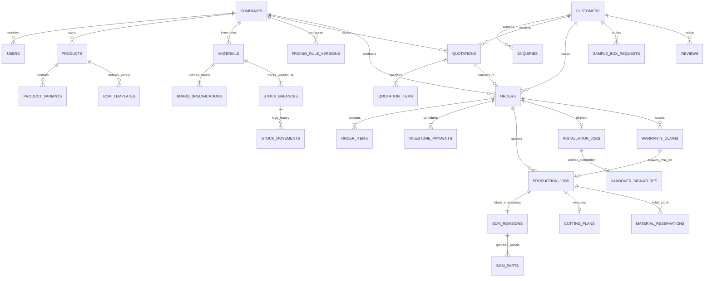

# SATCO AI Smart Furniture Platform
## Database Architecture, Data Models & Schema Specification

**Document Title:** Enterprise Database Architecture & Technical Schema Specification  
**Target Path:** `Database.md`  
**System Name:** SATCO AI Smart Furniture Platform  
**Target Market:** Kingdom of Saudi Arabia (Riyadh, Jeddah, Dammam)  
**Version:** 1.0 (Production Engineering Baseline)  
**Date:** November 2026  
**Status:** Approved for Development  
**Alignment Reference:** `PRD.md`, `Architecture.md`, `DFD.md`, `Requirements Validation.md`, `SATCO_Final_Project_Blueprint.md`  

---

## Executive Summary & Data Governance

This document provides the definitive, production-ready **Database Architecture** for the SATCO AI Smart Furniture Platform. It defines the complete persistence layer, covering relational integrity (PostgreSQL/Prisma), document ODM models (Mongoose/MongoDB compatibility), indexes, validation rules, ACID transactions, analytical aggregation pipelines, and Saudi Arabian market seed data.

### Core Data Integrity Principles:
1. **Zero Floating-Point Financial Representation:** All currency amounts (`SAR`), unit rates, labor wages, discounts, and ZATCA 15% VAT are stored as exact decimals (`Decimal(12, 4)` in Prisma / `mongoose.Types.Decimal128` in Mongoose).
2. **Normalized Metric Dimensions:** All dimensions (Width, Height, Depth, panel thicknesses, saw kerf, edge trim) are stored as integer millimeters ($mm$).
3. **Immutable Revisioning & Event Sourcing:** `PricingRuleVersion`, `BOMRevision`, `StockMovement`, and `AuditLog` records are strictly append-only. Zero `UPDATE` or `DELETE` operations are permitted.
4. **Saudi PDPL Privacy Redaction:** Plaintext customer names, phone numbers, and addresses are encrypted at rest (AES-256) and never stored on shop-floor part records.

---

## 1. Master Entity-Relationship Diagram (ERD)



---

## 2. Collection & Table Registry

| Entity / Collection Name | Primary Purpose | Storage Engine | Partitioning / TTL |
| :--- | :--- | :--- | :--- |
| **`companies`** | Multi-tenant company realms & subscription quotas | PostgreSQL / MongoDB | Permanent |
| **`users`** | Internal staff accounts (Admin, Sales, Factory, Store, Installer) | PostgreSQL / MongoDB | Permanent |
| **`customers`** | Customer identity, Saudi mobile (`+9665`), risk scoring | PostgreSQL / MongoDB | Permanent (PDPL Encrypted) |
| **`products`** | Furniture models, bilingual titles, dimension limits ($W, H, D$) | PostgreSQL / MongoDB | Soft Delete |
| **`product_variants`** | Finish, substrate, and hardware combination matrix | PostgreSQL / MongoDB | Soft Delete |
| **`materials`** | Core board catalog, edge-banding reels, hardware items | PostgreSQL / MongoDB | Soft Delete |
| **`board_specifications`** | Raw sheet dimensions ($2440 \times 1220\text{ mm}$), thicknesses, grain | PostgreSQL / MongoDB | Permanent |
| **`pricing_rule_versions`** | Version-controlled rate cards, formulas, margins, scrap factors | PostgreSQL / MongoDB | Append-Only (Immutable) |
| **`enquiries`** | Customer leads, design snapshots, SMS OTP tokens | PostgreSQL / MongoDB | 1-Year Retention |
| **`quotations`** | Commercial quote contracts, versioning, tiered discounts | PostgreSQL / MongoDB | 5-Year Legal Retention |
| **`orders`** | Binding sales orders, locked price snapshots, contract state | PostgreSQL / MongoDB | 10-Year Commercial Retention |
| **`milestone_payments`** | 3-stage payment ledger (50% Deposit, 40% Pre-Dispatch, 10% Handover) | PostgreSQL / MongoDB | 10-Year ZATCA Audit |
| **`production_jobs`** | Factory floor jobs, station state transitions, operator attribution | PostgreSQL / MongoDB | Active Lifecycle |
| **`bom_revisions`** | Versioned manufacturing definitions linked to orders | PostgreSQL / MongoDB | Permanent Linked Engineering |
| **`bom_parts`** | Extracted panel records (Raw/Finished sizes, edge codes, boring) | PostgreSQL / MongoDB | Permanent Linked Engineering |
| **`cutting_plans`** | 2D nesting packing coordinates, blade kerf, trim waste % | PostgreSQL / MongoDB | 3-Year Historical |
| **`stock_balances`** | Warehouse physical stock counts, reservations, reorder points | PostgreSQL / MongoDB | Real-Time Active |
| **`stock_movements`** | Transactional inventory ledger (`RECEIPT`, `ISSUE`, `RETURN`, `ADJ`) | PostgreSQL / MongoDB | Range Partitioned (Monthly) |
| **`installation_jobs`** | In-house fleet dispatch, morning/evening slots, site readiness | PostgreSQL / MongoDB | Active Lifecycle |
| **`handover_signatures`** | Customer digital e-signatures, GPS coordinates, inspection photos | PostgreSQL / MongoDB | Permanent Contract Evidence |
| **`warranty_claims`** | Defect reporting, 1/2-year warranty check, fast-track single-part RMA | PostgreSQL / MongoDB | 5-Year Warranty Lifecycle |
| **`coupons`** | Promotional discount codes, budget caps, non-stacking rules | PostgreSQL / MongoDB | Active Campaign Dates |
| **`sample_box_requests`** | Material swatch requests, showroom pickup / 100 SAR deposit vouchers| PostgreSQL / MongoDB | 1-Year Retention |
| **`reviews`** | Post-delivery verified buyer reviews, photo moderation queue | PostgreSQL / MongoDB | Permanent (Public Display) |
| **`audit_logs`** | Tamper-proof system mutations (Actor, IP, Previous/New State) | PostgreSQL / MongoDB | Range Partitioned (Monthly) |

---

## 3. Data Dictionary, Schema Specifications & Relationships

### 3.1 `companies` (Tenant Entity)
```sql
CREATE TABLE companies (
    id UUID PRIMARY KEY DEFAULT gen_random_uuid(),
    name_en VARCHAR(128) NOT NULL,
    name_ar VARCHAR(128) NOT NULL,
    slug VARCHAR(64) UNIQUE NOT NULL,
    vat_number VARCHAR(32) NOT NULL, -- 15-digit ZATCA VAT ID
    cr_number VARCHAR(32) NOT NULL,  -- Saudi Commercial Registration
    is_active BOOLEAN DEFAULT TRUE,
    created_at TIMESTAMP WITH TIME ZONE DEFAULT NOW(),
    updated_at TIMESTAMP WITH TIME ZONE DEFAULT NOW()
);
CREATE INDEX idx_companies_slug ON companies(slug);
```

### 3.2 `users` & `customers`
```sql
CREATE TABLE users (
    id UUID PRIMARY KEY DEFAULT gen_random_uuid(),
    company_id UUID NOT NULL REFERENCES companies(id) ON DELETE CASCADE,
    email VARCHAR(128) NOT NULL,
    password_hash VARCHAR(255) NOT NULL,
    name_en VARCHAR(128) NOT NULL,
    name_ar VARCHAR(128) NOT NULL,
    role VARCHAR(32) NOT NULL, -- ADMIN, SALES_REP, SALES_MGR, PM, STORE, OPERATOR, INSTALLER
    phone_number VARCHAR(16) NOT NULL,
    is_active BOOLEAN DEFAULT TRUE,
    created_at TIMESTAMP WITH TIME ZONE DEFAULT NOW(),
    updated_at TIMESTAMP WITH TIME ZONE DEFAULT NOW(),
    UNIQUE(company_id, email)
);
CREATE INDEX idx_users_lookup ON users(company_id, role, is_active);

CREATE TABLE customers (
    id UUID PRIMARY KEY DEFAULT gen_random_uuid(),
    company_id UUID NOT NULL REFERENCES companies(id),
    name VARCHAR(128) NOT NULL,
    phone_number VARCHAR(16) NOT NULL, -- +9665xxxxxxxx E.164
    email VARCHAR(128) NULL,
    national_id VARCHAR(32) NULL,      -- Encrypted at rest
    city VARCHAR(64) NOT NULL,          -- Riyadh, Jeddah, Dammam
    address_short_code VARCHAR(16) NULL, -- Saudi National Address e.g. RRRD2929
    risk_score INT DEFAULT 0,          -- 0 (Trusted) to 100 (Fraud Alert)
    is_blacklisted BOOLEAN DEFAULT FALSE,
    created_at TIMESTAMP WITH TIME ZONE DEFAULT NOW(),
    UNIQUE(company_id, phone_number)
);
CREATE INDEX idx_customers_phone ON customers(company_id, phone_number);
```

### 3.3 `products` & `pricing_rule_versions`
```sql
CREATE TABLE products (
    id UUID PRIMARY KEY DEFAULT gen_random_uuid(),
    company_id UUID NOT NULL REFERENCES companies(id),
    sku_prefix VARCHAR(32) NOT NULL,
    title_en VARCHAR(255) NOT NULL,
    title_ar VARCHAR(255) NOT NULL,
    category VARCHAR(64) NOT NULL,
    min_width_mm INT NOT NULL CHECK (min_width_mm > 0),
    max_width_mm INT NOT NULL CHECK (max_width_mm >= min_width_mm),
    default_width_mm INT NOT NULL,
    min_height_mm INT NOT NULL CHECK (min_height_mm > 0),
    max_height_mm INT NOT NULL CHECK (max_height_mm >= min_height_mm),
    default_height_mm INT NOT NULL,
    min_depth_mm INT NOT NULL CHECK (min_depth_mm > 0),
    max_depth_mm INT NOT NULL CHECK (max_depth_mm >= min_depth_mm),
    default_depth_mm INT NOT NULL,
    step_span_mm INT DEFAULT 900,      -- Structural partition threshold
    is_published BOOLEAN DEFAULT FALSE,
    created_at TIMESTAMP WITH TIME ZONE DEFAULT NOW(),
    deleted_at TIMESTAMP WITH TIME ZONE NULL
);
CREATE INDEX idx_products_published ON products(company_id, category, is_published);

CREATE TABLE pricing_rule_versions (
    id UUID PRIMARY KEY DEFAULT gen_random_uuid(),
    company_id UUID NOT NULL REFERENCES companies(id),
    version_tag VARCHAR(32) NOT NULL,  -- e.g. "v2026.1"
    board_cost_sqm NUMERIC(12, 4) NOT NULL,
    edge_cost_meter NUMERIC(12, 4) NOT NULL,
    hardware_base_rate NUMERIC(12, 4) NOT NULL,
    labor_hourly_rate NUMERIC(12, 4) NOT NULL,
    standard_scrap_factor NUMERIC(6, 4) NOT NULL DEFAULT 0.1000, -- 10%
    standard_margin_rate NUMERIC(6, 4) NOT NULL DEFAULT 0.3500,  -- 35%
    is_active BOOLEAN DEFAULT TRUE,
    created_by UUID NOT NULL REFERENCES users(id),
    effective_from TIMESTAMP WITH TIME ZONE DEFAULT NOW()
);
CREATE INDEX idx_pricing_active ON pricing_rule_versions(company_id, is_active, effective_from DESC);
```

### 3.4 `orders` & `milestone_payments`
```sql
CREATE TABLE orders (
    id UUID PRIMARY KEY DEFAULT gen_random_uuid(),
    company_id UUID NOT NULL REFERENCES companies(id),
    order_number VARCHAR(32) UNIQUE NOT NULL, -- ORD-2026-XXXXX
    customer_id UUID NOT NULL REFERENCES customers(id),
    quotation_id UUID NOT NULL REFERENCES quotations(id),
    status VARCHAR(32) NOT NULL, -- PENDING_DEPOSIT, IN_PRODUCTION, DISPATCH_HOLD, INSTALLED_HANDOVER, CLOSED
    net_total_sar NUMERIC(12, 4) NOT NULL,
    vat_total_sar NUMERIC(12, 4) NOT NULL,
    gross_total_sar NUMERIC(12, 4) NOT NULL,
    deposit_verified_at TIMESTAMP WITH TIME ZONE NULL, -- Required for saw cut (BR-SEC-005)
    due_balance_sar NUMERIC(12, 4) NOT NULL,
    created_at TIMESTAMP WITH TIME ZONE DEFAULT NOW(),
    updated_at TIMESTAMP WITH TIME ZONE DEFAULT NOW()
);
CREATE INDEX idx_orders_status ON orders(company_id, status);
CREATE INDEX idx_orders_customer ON orders(customer_id);

CREATE TABLE milestone_payments (
    id UUID PRIMARY KEY DEFAULT gen_random_uuid(),
    order_id UUID NOT NULL REFERENCES orders(id) ON DELETE CASCADE,
    milestone_index INT NOT NULL,      -- 1: Deposit (50%), 2: Pre-Dispatch (40%), 3: Handover (10%)
    percentage NUMERIC(5, 2) NOT NULL,
    amount_sar NUMERIC(12, 4) NOT NULL,
    status VARCHAR(32) NOT NULL,       -- PENDING, OVERDUE, PAID, REFUNDED
    due_date DATE NOT NULL,
    paid_at TIMESTAMP WITH TIME ZONE NULL,
    transaction_ref VARCHAR(64) NULL,
    payment_method VARCHAR(32) NULL,   -- mada, apple_pay, bank_transfer
    created_at TIMESTAMP WITH TIME ZONE DEFAULT NOW()
);
CREATE INDEX idx_milestones_due ON milestone_payments(order_id, status, due_date);
```

### 3.5 `bom_revisions` & `bom_parts`
```sql
CREATE TABLE bom_revisions (
    id UUID PRIMARY KEY DEFAULT gen_random_uuid(),
    order_id UUID NOT NULL REFERENCES orders(id),
    revision_tag VARCHAR(16) NOT NULL, -- "Rev-A", "Rev-B"
    is_released BOOLEAN DEFAULT FALSE,
    released_by UUID NULL REFERENCES users(id),
    released_at TIMESTAMP WITH TIME ZONE NULL,
    created_at TIMESTAMP WITH TIME ZONE DEFAULT NOW()
);

CREATE TABLE bom_parts (
    id UUID PRIMARY KEY DEFAULT gen_random_uuid(),
    bom_revision_id UUID NOT NULL REFERENCES bom_revisions(id) ON DELETE CASCADE,
    part_code VARCHAR(32) NOT NULL,    -- GABLE_LEFT_01
    name_en VARCHAR(128) NOT NULL,
    name_ar VARCHAR(128) NOT NULL,
    raw_length_mm INT NOT NULL,
    raw_width_mm INT NOT NULL,
    finished_length_mm INT NOT NULL,
    finished_width_mm INT NOT NULL,
    thickness_mm INT NOT NULL,
    grain_orientation VARCHAR(16) NOT NULL, -- ALONG_LENGTH, ALONG_WIDTH, NONE
    edge_banding JSONB NOT NULL,       -- { "L1": "2MM", "L2": "NONE", "W1": "1MM", "W2": "1MM" }
    cnc_drill_ops JSONB NULL,          -- Drill hole coordinates [{x, y, z, diameter}]
    barcode_token VARCHAR(64) UNIQUE NOT NULL, -- Opaque UUID for thermal labels (BR-SEC-004)
    created_at TIMESTAMP WITH TIME ZONE DEFAULT NOW()
);
CREATE INDEX idx_bom_parts_lookup ON bom_parts(bom_revision_id, part_code);
CREATE INDEX idx_bom_parts_barcode ON bom_parts(barcode_token);
```

### 3.6 `stock_movements` (Immutable Warehouse Ledger)
```sql
CREATE TABLE stock_movements (
    id UUID PRIMARY KEY DEFAULT gen_random_uuid(),
    company_id UUID NOT NULL REFERENCES companies(id),
    material_id UUID NOT NULL REFERENCES materials(id),
    movement_type VARCHAR(32) NOT NULL, -- RECEIPT, ISSUE_TO_JOB, RETURN_FROM_JOB, ADJUSTMENT
    quantity_delta INT NOT NULL,
    balance_after INT NOT NULL,
    reference_id VARCHAR(64) NOT NULL,  -- PO-1029, JOB-44, or Scrap Reason
    actor_id UUID NOT NULL REFERENCES users(id),
    created_at TIMESTAMP WITH TIME ZONE DEFAULT NOW()
) PARTITION BY RANGE (created_at);

-- Monthly Range Partitioning Example
CREATE TABLE stock_movements_2026_11 PARTITION OF stock_movements
    FOR VALUES FROM ('2026-11-01') TO ('2026-12-01');
```

---

## 4. Database Indexes & Performance Optimization

```sql
-- 1. High-Performance Foreign Key & Filtering Indexes
CREATE INDEX idx_orders_company_status ON orders(company_id, status);
CREATE INDEX idx_production_jobs_status ON production_jobs(company_id, status);
CREATE INDEX idx_quotations_lookup ON quotations(company_id, customer_id, status);

-- 2. Unique Constraints & Security Indexes
CREATE UNIQUE INDEX idx_unique_active_company_sku ON products(company_id, sku_prefix) WHERE deleted_at IS NULL;
CREATE UNIQUE INDEX idx_unique_active_quote_version ON quotations(quotation_number, version_index);

-- 3. Composite & GIN Indexes for JSONB Fields
CREATE INDEX idx_bom_parts_edge_gin ON bom_parts USING GIN (edge_banding);
CREATE INDEX idx_cutting_plans_layout_gin ON cutting_plans USING GIN (layout_data);

-- 4. Audit Log Query Optimization (Monthly Partitioning)
CREATE INDEX idx_audit_lookup ON audit_logs(company_id, entity_name, entity_id, created_at DESC);
```

---

## 5. Zod Validation Schemas (Server-Side Ingestion Layer)

Every API endpoint and Server Action re-validates incoming payloads using strict Zod schemas before touching Prisma/PostgreSQL.

```typescript
import { z } from "zod";

// 1. Parametric Dimension Validation Schema
export const DimensionInputSchema = z.object({
  width: z.number().int().min(400, "Width cannot be less than 400mm").max(3000, "Width cannot exceed 3000mm"),
  height: z.number().int().min(600, "Height cannot be less than 600mm").max(3200, "Height cannot exceed 3200mm"),
  depth: z.number().int().min(300, "Depth cannot be less than 300mm").max(1200, "Depth cannot exceed 1200mm"),
});

// 2. Saudi Mobile Number & Identity Schema
export const SaudiCustomerSchema = z.object({
  name: z.string().min(3, "Name must be at least 3 characters").max(100),
  phoneNumber: z.string().regex(/^(?:\+966|00966|0)?5[0-9]{8}$/, "Invalid Saudi mobile format. Must start with 05 or +9665"),
  city: z.enum(["Riyadh", "Jeddah", "Dammam", "Khobar", "Mecca", "Medina"]),
  addressShortCode: z.string().regex(/^[A-Z]{4}[0-9]{4}$/, "Invalid Saudi National Address format (e.g. RRRD2929)").optional(),
});

// 3. Discount Authority Validation Schema (BR-PRICE-004)
export const DiscountApprovalSchema = z.object({
  quoteId: z.string().uuid(),
  discountPercentage: z.number().min(0.0).max(50.0), // Hard ceiling 50%
  approverRole: z.enum(["SALES_REP", "SALES_MANAGER", "COMPANY_ADMIN"]),
}).refine((data) => {
  if (data.discountPercentage > 5.0 && data.approverRole === "SALES_REP") return false;
  if (data.discountPercentage > 15.0 && data.approverRole === "SALES_MANAGER") return false;
  return true;
}, {
  message: "Unauthorized discount: Percentage exceeds your role approval ceiling.",
  path: ["discountPercentage"]
});
```

---

## 6. Analytical Aggregation Pipelines (Executive BI & Yield Queries)

### 6.1 Factory Scrap Yield & Material Waste Analysis (SQL & MongoDB)

#### SQL Aggregation (Executing on PostgreSQL Read-Replica):
```sql
SELECT 
    m.name_en AS substrate_name,
    COUNT(cp.id) AS total_plans,
    SUM(cp.sheet_count) AS total_sheets_consumed,
    ROUND(AVG(cp.total_scrap_percentage), 2) AS avg_scrap_percent,
    SUM(cp.total_scrap_percentage * cp.sheet_count * (2.44 * 1.22)) AS estimated_scrap_sqm
FROM cutting_plans cp
JOIN board_specifications bs ON cp.board_specification_id = bs.id
JOIN materials m ON bs.material_id = m.id
WHERE cp.created_at >= NOW() - INTERVAL '30 days'
GROUP BY m.name_en
ORDER BY avg_scrap_percent DESC;
```

### 6.2 Accounts Receivable 30/60/90-Day Due Aging Pipeline (MongoDB / Aggregation)
```javascript
db.milestone_payments.aggregate([
  {
    $match: {
      status: "OVERDUE",
      company_id: ObjectId("674567890123456789012345")
    }
  },
  {
    $project: {
      order_id: 1,
      amount_sar: 1,
      due_date: 1,
      days_overdue: {
        $divide: [{ $subtract: [new Date(), "$due_date"] }, 1000 * 60 * 60 * 24]
      }
    }
  },
  {
    $bucket: {
      groupBy: "$days_overdue",
      boundaries: [1, 16, 31, 61, 91],
      default: "Over 90 Days",
      output: {
        count: { $sum: 1 },
        total_due_sar: { $sum: "$amount_sar" },
        orders: { $push: "$order_id" }
      }
    }
  }
]);
```

---

## 7. ACID Transaction Boundaries

All multi-table mutations are wrapped in database transactions to guarantee atomic integrity.

### 7.1 Quotation-to-Order Conversion Transaction (Prisma)
```typescript
export async function convertQuotationToOrder(quoteId: string, depositAmount: Decimal, actorId: string) {
  return await prisma.$transaction(async (tx) => {
    // 1. Fetch and Lock Quotation
    const quote = await tx.quotation.findUniqueOrThrow({
      where: { id: quoteId },
      include: { items: true, customer: true }
    });

    if (quote.status !== "CUSTOMER_ACCEPTED") {
      throw new Error("Invalid state: Quote must be CUSTOMER_ACCEPTED to convert.");
    }

    // 2. Create Commercial Order
    const orderNumber = `ORD-2026-${Math.floor(10000 + Math.random() * 90000)}`;
    const newOrder = await tx.order.create({
      data: {
        company_id: quote.company_id,
        order_number: orderNumber,
        customer_id: quote.customer_id,
        quotation_id: quote.id,
        status: "DEPOSIT_CONFIRMED",
        net_total_sar: quote.net_total_sar,
        vat_total_sar: quote.vat_total_sar,
        gross_total_sar: quote.gross_total_sar,
        deposit_verified_at: new Date(),
        due_balance_sar: quote.gross_total_sar.minus(depositAmount)
      }
    });

    // 3. Schedule 3-Stage Milestone Ledger
    const deposit50 = quote.gross_total_sar.mul(0.50);
    const preDispatch40 = quote.gross_total_sar.mul(0.40);
    const handover10 = quote.gross_total_sar.mul(0.10);

    await tx.milestonePayment.createMany({
      data: [
        { order_id: newOrder.id, milestone_index: 1, percentage: 50.0, amount_sar: deposit50, status: "PAID", due_date: new Date(), paid_at: new Date() },
        { order_id: newOrder.id, milestone_index: 2, percentage: 40.0, amount_sar: preDispatch40, status: "PENDING", due_date: new Date(Date.now() + 14 * 86400000) },
        { order_id: newOrder.id, milestone_index: 3, percentage: 10.0, amount_sar: handover10, status: "PENDING", due_date: new Date(Date.now() + 21 * 86400000) }
      ]
    });

    // 4. Update Quotation Status to CONVERTED
    await tx.quotation.update({
      where: { id: quote.id },
      data: { status: "CONVERTED" }
    });

    // 5. Append Audit Record
    await tx.auditLog.create({
      data: {
        company_id: quote.company_id,
        entity_name: "Order",
        entity_id: newOrder.id,
        actor_id: actorId,
        action: "CONVERT_QUOTE_TO_ORDER",
        new_state: { order_number: orderNumber, gross_total: quote.gross_total_sar.toString() }
      }
    });

    return newOrder;
  });
}
```

---

## 8. Mongoose Schema Models (TypeScript / MongoDB ODM)

For developers deploying document-based microservices or MongoDB event layers, the following production Mongoose schemas mirror the relational models:

```typescript
import mongoose, { Schema, Document } from "mongoose";

// 1. Order Schema (Mongoose)
export interface IOrder extends Document {
  company_id: mongoose.Types.ObjectId;
  order_number: string;
  customer_id: mongoose.Types.ObjectId;
  status: string;
  net_total_sar: mongoose.Types.Decimal128;
  vat_total_sar: mongoose.Types.Decimal128;
  gross_total_sar: mongoose.Types.Decimal128;
  deposit_verified_at?: Date;
  due_balance_sar: mongoose.Types.Decimal128;
}

const OrderSchema = new Schema<IOrder>({
  company_id: { type: Schema.Types.ObjectId, ref: "Company", required: true, index: true },
  order_number: { type: String, required: true, unique: true, index: true },
  customer_id: { type: Schema.Types.ObjectId, ref: "Customer", required: true, index: true },
  status: { 
    type: String, 
    required: true, 
    enum: ["PENDING_DEPOSIT", "DEPOSIT_CONFIRMED", "IN_PRODUCTION", "DISPATCH_HOLD", "INSTALLED_HANDOVER", "CLOSED"],
    default: "PENDING_DEPOSIT",
    index: true
  },
  net_total_sar: { type: Schema.Types.Decimal128, required: true },
  vat_total_sar: { type: Schema.Types.Decimal128, required: true },
  gross_total_sar: { type: Schema.Types.Decimal128, required: true },
  deposit_verified_at: { type: Date, default: null },
  due_balance_sar: { type: Schema.Types.Decimal128, required: true }
}, { timestamps: true });

export const OrderModel = mongoose.model<IOrder>("Order", OrderSchema);

// 2. BOM Part Schema (Mongoose)
export interface IBOMPart extends Document {
  bom_revision_id: mongoose.Types.ObjectId;
  part_code: string;
  raw_length_mm: number;
  raw_width_mm: number;
  thickness_mm: number;
  grain_orientation: string;
  edge_banding: Record<string, string>;
  barcode_token: string;
}

const BOMPartSchema = new Schema<IBOMPart>({
  bom_revision_id: { type: Schema.Types.ObjectId, ref: "BOMRevision", required: true, index: true },
  part_code: { type: String, required: true },
  raw_length_mm: { type: Number, required: true },
  raw_width_mm: { type: Number, required: true },
  thickness_mm: { type: Number, required: true },
  grain_orientation: { type: String, enum: ["ALONG_LENGTH", "ALONG_WIDTH", "NONE"], required: true },
  edge_banding: { type: Map, of: String, required: true },
  barcode_token: { type: String, required: true, unique: true, index: true }
}, { timestamps: true });

export const BOMPartModel = mongoose.model<IBOMPart>("BOMPart", BOMPartSchema);
```

---

## 9. Realistic Saudi Market Seed Data (JSON Sample)

```json
{
  "company": {
    "name_en": "SATCO Smart Furniture Co.",
    "name_ar": "شركة ساتكو للأثاث الذكي",
    "slug": "satco-saudi",
    "cr_number": "1010998877",
    "vat_number": "300099887700003"
  },
  "customer": {
    "name": "Eng. Faisal Al-Otaibi",
    "phone_number": "+966501234567",
    "email": "faisal.otaibi@example.sa",
    "city": "Riyadh",
    "address_short_code": "RRRD2929",
    "risk_score": 5,
    "is_blacklisted": false
  },
  "product": {
    "sku_prefix": "SATCO-WARDROBE-MOD",
    "title_en": "Master Bedroom Modular Wardrobe",
    "title_ar": "خزانة ملابس غرف النوم الرئيسية المعيارية",
    "category": "Wardrobes",
    "min_width_mm": 1200,
    "max_width_mm": 3200,
    "default_width_mm": 2400,
    "default_height_mm": 2600,
    "default_depth_mm": 600,
    "step_span_mm": 900
  },
  "pricing_rule_version": {
    "version_tag": "v2026.Q4-KSA",
    "board_cost_sqm": "85.0000",
    "edge_cost_meter": "4.5000",
    "hardware_base_rate": "350.0000",
    "labor_hourly_rate": "65.0000",
    "standard_scrap_factor": "0.1000",
    "standard_margin_rate": "0.3500"
  },
  "order": {
    "order_number": "ORD-2026-0044",
    "status": "DEPOSIT_CONFIRMED",
    "net_total_sar": "12500.0000",
    "vat_total_sar": "1875.0000",
    "gross_total_sar": "14375.0000",
    "due_balance_sar": "7187.5000",
    "milestones": [
      { "index": 1, "desc": "50% Commitment Deposit", "amount_sar": "7187.5000", "status": "PAID" },
      { "index": 2, "desc": "40% Pre-Dispatch Balance", "amount_sar": "5750.0000", "status": "PENDING" },
      { "index": 3, "desc": "10% Final Handover E-Sign", "amount_sar": "1437.5000", "status": "PENDING" }
    ]
  },
  "homag_cnc_bom_sample": [
    {
      "part_code": "GABLE_LEFT_01",
      "name_en": "Left Side Gable Panel",
      "name_ar": "اللوح الجانبي الأيسر",
      "raw_length_mm": 2596,
      "raw_width_mm": 596,
      "finished_length_mm": 2600,
      "finished_width_mm": 600,
      "thickness_mm": 18,
      "grain_orientation": "ALONG_LENGTH",
      "edge_banding": { "L1": "2MM_PVC", "L2": "NONE", "W1": "1MM_PVC", "W2": "1MM_PVC" },
      "barcode_token": "a1b2c3d4-e5f6-7890-abcd-ef1234567890"
    }
  ]
}
```

---

## Architectural Sign-Off

This document constitutes the definitive engineering database specification for the SATCO AI Smart Furniture Platform. All schema migrations, database seeding scripts, and ORM/ODM models must adhere strictly to the definitions herein.

**Approved by:** Lead Enterprise Solution Architect & Principal Database Administrator  
**Distribution:** Backend Engineering Team, DBA, DevOps Team, Executive Leadership  
