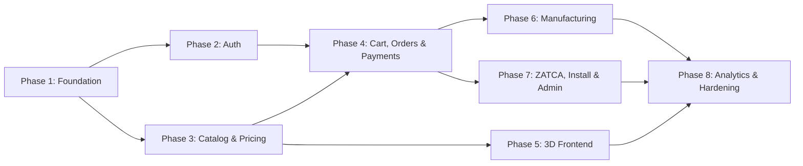

# SATCO AI Smart Furniture Platform
## Master Build Prompt — Step-by-Step Feature-by-Feature Implementation Guide

**Document Title:** Master Build Prompt & Implementation Roadmap  
**File Path:** `prisma/prompt.md`  
**System:** SATCO AI Smart Furniture Platform  
**Target Market:** Kingdom of Saudi Arabia (Riyadh, Dammam,makkah,madinah,Jeddah and all KSA cities)  
**Tech Stack:** Next.js 15 (App Router) · TypeScript · Tailwind CSS · Prisma 5 · PostgreSQL 15 · Redis · BullMQ · `decimal.js` · Zod · `next-intl`  
**Source Documents:** `PRD.md`, `Architecture.md`, `Database.md`, `src/database-schema.md`, `src/Api-spac.md`, `idea.md`, `DFD.md`, `Requirements Validation.md`  
**Date:** November 2026  
**Status:** Active Build Guide  

---

## How to Use This Document

This file is the **single authoritative build instruction** for the SATCO platform. It breaks the entire project into **8 ordered Phases**, each containing numbered **Features**. Each Feature specifies:
- **What** to build (files, functions, components).
- **Why** it matters (linked business rule or PRD requirement).
- **How** to validate it (acceptance criteria, tests to run).
- **Dependencies** (which Features must be completed first).

> [!IMPORTANT]
> Build Features **strictly in the order listed**. Each Phase gates the next. Do NOT skip ahead to Phase 5 (3D Configurator) without completing Phase 2 (Auth) and Phase 3 (Catalog & Pricing). The dependency graph is physically enforced by database foreign keys and API contracts.

---

## Current Project State (Already Completed)

The following foundational artifacts and code already exist in the workspace:

| Item | File | Status |
| :--- | :--- | :--- |
| Product Requirements Document | `PRD.md` (204 KB, 24 modules) | ✅ Complete |
| System Architecture | `Architecture.md` (57 KB, 17 sections) | ✅ Complete |
| Data Flow Diagrams | `DFD.md` (32 KB, Mermaid + Draw.io XML) | ✅ Complete |
| Database Architecture | `Database.md` (27 KB, ERD + DDL) | ✅ Complete |
| Database Schema Reference | `src/database-schema.md` (47 KB) | ✅ Complete |
| API Specification | `src/Api-spac.md` (35 KB, 9 modules) | ✅ Complete |
| Requirements Validation | `Requirements Validation.md` (57 KB) | ✅ Complete |
| Feature Ideation Backlog | `idea.md` (16 KB, 4 pillars) | ✅ Complete |
| Prisma ORM Schema | `prisma/schema.prisma` (25 tables, validated ✅) | ✅ Complete |
| Saudi Seed Data Script | `prisma/seed.ts` | ✅ Complete |
| Decimal.js Math Library | `src/lib/decimal.ts` | ✅ Complete |
| Saudi Validators (Zod) | `src/lib/validation/saudi-validators.ts` | ✅ Complete |
| Pricing Engine Service | `src/modules/pricing/pricing.service.ts` | ✅ Complete |
| Pricing Engine Unit Tests | `src/modules/pricing/__tests__/pricing.test.ts` (2/2 PASS) | ✅ Complete |
| Project Config | `package.json`, `tsconfig.json`, `tailwind.config.ts`, `.env.example` | ✅ Complete |

---

## Phase 1: Foundation Layer & Infrastructure (Sprint 1 — Days 1-5)

### Feature 1.1: PostgreSQL Database Provisioning & Initial Migration
- **Goal:** Create a live PostgreSQL 15 database and run Prisma migrations to generate all 25 tables with indexes and constraints.
- **Commands:**
  ```bash
  # Ensure PostgreSQL is running and .env DATABASE_URL is correct
  npx prisma migrate dev --name init_satco_schema
  npx prisma db seed
  ```
- **Acceptance:** `npx prisma studio` opens and shows all 25 tables. Seed data visible (SATCO company, Egger materials, Blum hardware, Pricing Rule).
- **Files:** `prisma/schema.prisma` (exists), `prisma/seed.ts` (exists), `.env` (exists).
- **Dependencies:** None (this is the root).

### Feature 1.2: Prisma Client Singleton & Database Connection Utility
- **Goal:** Create a production-safe Prisma client singleton that prevents connection exhaustion during Next.js hot-reload.
- **File to Create:** `src/lib/prisma.ts`
- **Implementation:**
  ```typescript
  import { PrismaClient } from '@prisma/client';
  const globalForPrisma = globalThis as unknown as { prisma: PrismaClient };
  export const prisma = globalForPrisma.prisma ?? new PrismaClient({ log: ['warn', 'error'] });
  if (process.env.NODE_ENV !== 'production') globalForPrisma.prisma = prisma;
  export default prisma;
  ```
- **Acceptance:** Import works from any Server Component or API route without "too many connections" errors.
- **Dependencies:** Feature 1.1.

### Feature 1.3: Next.js 15 App Router Bilingual Layout (Arabic RTL / English LTR)
- **Goal:** Create the root App Router layout with `next-intl` supporting `ar` (default, RTL) and `en` (LTR).
- **Files to Create:**
  - `src/app/[locale]/layout.tsx` — Root layout with `dir={locale === 'ar' ? 'rtl' : 'ltr'}`, Cairo font for Arabic, Inter for English.
  - `src/app/[locale]/page.tsx` — Landing page placeholder.
  - `src/i18n/request.ts` — Locale request handler.
  - `src/middleware.ts` — `next-intl` middleware for locale detection & routing.
  - `messages/ar.json`, `messages/en.json` — Translation string files.
- **Acceptance:** `npm run dev` → `http://localhost:3000/ar` renders RTL Arabic layout; `/en` renders LTR English layout.
- **Dependencies:** Feature 1.2.

### Feature 1.4: Global API Response Envelope & Error Handler Middleware
- **Goal:** Create a centralized API response builder and error handler that enforces the RFC 7807 extended envelope from `Api-spac.md`.
- **Files to Create:**
  - `src/lib/api/response.ts` — `successResponse()`, `errorResponse()` builder functions.
  - `src/lib/api/errors.ts` — Typed error classes: `ValidationError`, `AuthError`, `ForbiddenError`, `NotFoundError`, `DomainRuleError`, `ConflictError`.
  - `src/lib/api/middleware.ts` — `withErrorHandler()` HOF that wraps Next.js Route Handlers, catches thrown errors, logs with PDPL-safe masking, and returns structured JSON.
- **Business Rules:** `Api-spac.md` Section 1.3 (Response Envelope), Section 5.2 (RFC 7807), Section 5.6 (Saudi PDPL Log Redaction).
- **Acceptance:** Unit test that throws each error class and validates the JSON response structure.
- **Dependencies:** Feature 1.3.

### Feature 1.5: Redis Connection & BullMQ Queue Setup
- **Goal:** Create Redis client singleton and BullMQ queue definitions for background jobs (SMS delivery, ZATCA clearance, payment webhooks).
- **Files to Create:**
  - `src/lib/redis.ts` — ioredis singleton.
  - `src/lib/queue/index.ts` — Named queues: `sms-otp`, `payment-webhook`, `zatca-clearance`, `installation-notification`.
- **Dependencies:** Feature 1.2.

---

## Phase 2: Authentication & Identity (Sprint 1-2 — Days 3-8)

### Feature 2.1: SMS OTP Request & Delivery Service
- **Goal:** Implement `POST /api/v1/auth/otp/request` that validates Saudi mobile numbers, rate-limits (3/10min), generates 4-digit OTP, stores hash in Redis (3-min TTL), and queues SMS delivery.
- **Files to Create:**
  - `src/app/api/v1/auth/otp/request/route.ts`
  - `src/modules/auth/otp.service.ts` — OTP generation, Redis storage, rate-limiting logic.
  - `src/modules/auth/sms.adapter.ts` — Taqnyat/Unifonic SMS gateway adapter (mock mode via `.env`).
- **Business Rules:** `BR-SEC-001` (Saudi mobile regex), `Api-spac.md` Module 1.1.
- **Acceptance:** `POST /api/v1/auth/otp/request` with `{"phoneNumber": "0501234567"}` returns normalized `+966501234567` and `expiresInSeconds: 180`.
- **Dependencies:** Features 1.2, 1.4, 1.5.

### Feature 2.2: OTP Verification, Blacklist Check & JWT Issuance
- **Goal:** Implement `POST /api/v1/auth/otp/verify` that verifies OTP, checks fraud blacklist, upserts customer User + CustomerProfile, and returns signed JWT.
- **Files to Create:**
  - `src/app/api/v1/auth/otp/verify/route.ts`
  - `src/modules/auth/jwt.service.ts` — HS256 JWT sign/verify with configurable expiry.
  - `src/modules/auth/blacklist.service.ts` — Checks `blacklist_entries` table by phone.
- **Business Rules:** `BR-SEC-001`, `Api-spac.md` Module 1.2.
- **Acceptance:** Returns `403 ACCOUNT_BLACKLISTED` for blacklisted phone; `200` with valid Bearer JWT for clean phone.
- **Dependencies:** Feature 2.1.

### Feature 2.3: Staff Email/Password Login
- **Goal:** Implement `POST /api/v1/auth/staff/login` for internal roles (SUPER_ADMIN, FACTORY_MANAGER, ESTIMATOR, INSTALLER_TECHNICIAN).
- **Files to Create:**
  - `src/app/api/v1/auth/staff/login/route.ts`
- **Business Rules:** `Api-spac.md` Module 1.3. Bcrypt cost 12 password hashing.
- **Dependencies:** Feature 2.2.

### Feature 2.4: Auth Guard Middleware & Role-Based Access Control (RBAC)
- **Goal:** Create reusable middleware that extracts Bearer JWT, validates token, injects `currentUser` into request context, and enforces role-based route protection.
- **Files to Create:**
  - `src/lib/api/auth-guard.ts` — `withAuth(handler, { roles: ['CUSTOMER', 'SUPER_ADMIN'] })`.
- **Acceptance:** Protected routes return `401` without token and `403` for insufficient role.
- **Dependencies:** Feature 2.2.

---

## Phase 3: Product Catalog, Materials & Pricing Engine (Sprint 2 — Days 6-12)

### Feature 3.1: Category & Product Template CRUD API
- **Goal:** Implement `GET /api/v1/configurator/templates` (public) and admin CRUD endpoints for Categories and ProductTemplates.
- **Files to Create:**
  - `src/app/api/v1/configurator/templates/route.ts`
  - `src/app/api/v1/admin/categories/route.ts`
  - `src/modules/catalog/catalog.service.ts`
- **Acceptance:** Public endpoint returns templates with dimension limits, base price, and category info.
- **Dependencies:** Features 1.1, 1.4.

### Feature 3.2: Material Sheets, Hardware & Edge-Banding Catalog API
- **Goal:** Implement `GET /api/v1/configurator/materials` returning active Egger sheets, Blum hardware, and Rehau edge-bandings.
- **Files to Create:**
  - `src/app/api/v1/configurator/materials/route.ts`
  - `src/modules/catalog/materials.service.ts`
- **Acceptance:** Returns grouped materials with bilingual names, prices, texture URLs, and stock availability.
- **Dependencies:** Feature 1.1.

### Feature 3.3: Real-Time Parametric Pricing Calculation API
- **Goal:** Implement `POST /api/v1/configurator/calculate-price` using the existing `PricingEngineService`. Loads active `PricingRule` from DB and material costs dynamically.
- **Files to Create:**
  - `src/app/api/v1/configurator/calculate-price/route.ts`
- **Business Rules:** `BR-PRICE-001`, `BR-PRICE-002`, `BR-PRICE-003` (zero guesswork fallback). All math via `decimal.js`. ZATCA 15% VAT exact.
- **Acceptance:** Returns detailed breakdown: rawMaterial, edgeBanding, hardware, labor, margin, VAT, grandTotal, 3-tier milestones. Sum of milestones equals grandTotal exactly (zero penny discrepancy).
- **Dependencies:** Features 3.1, 3.2. Uses existing `src/modules/pricing/pricing.service.ts`.

### Feature 3.4: Promotional Coupon Engine
- **Goal:** Create coupon creation (admin), validation, and application logic.
- **Files to Create:**
  - `src/modules/pricing/coupon.service.ts`
  - `src/app/api/v1/admin/coupons/route.ts`
- **Business Rules:** `idea.md` Section 1.4. Non-stackable with discretionary discounts. Per-customer usage caps. Budget spend ceiling.
- **Dependencies:** Feature 3.3.

---

## Phase 4: Shopping Cart, Orders & Payment Processing (Sprint 3 — Days 10-18)

### Feature 4.1: Guest & Authenticated Shopping Cart
- **Goal:** Implement `GET /api/v1/cart`, `POST /api/v1/cart/items`, `PATCH /api/v1/cart/items/:id`, `DELETE /api/v1/cart/items/:id`.
- **Files to Create:**
  - `src/app/api/v1/cart/route.ts`
  - `src/app/api/v1/cart/items/route.ts`
  - `src/modules/cart/cart.service.ts`
- **Logic:** Guest carts use `X-Session-ID` header; authenticated users auto-merge guest cart into user cart on login.
- **Dependencies:** Features 2.4, 3.3.

### Feature 4.2: Checkout — Order Creation & Milestone Scheduling
- **Goal:** Implement `POST /api/v1/orders/checkout`. Converts cart into binding Order with `PENDING_DEPOSIT` status, creates 3-stage milestones, generates Milestone 1 invoice.
- **Files to Create:**
  - `src/app/api/v1/orders/checkout/route.ts`
  - `src/modules/orders/order.service.ts` — Prisma `$transaction` wrapping cart→order conversion.
  - `src/modules/orders/milestone.service.ts`
- **Business Rules:** `BR-ORD-001` (locked pricing snapshot), `BR-ORD-005` (dispatch hold). `X-Idempotency-Key` required.
- **Acceptance:** Order created with 50%/40%/10% milestones. Milestone amounts sum to grandTotal exactly.
- **Dependencies:** Feature 4.1.

### Feature 4.3: Order State Machine & Timeline
- **Goal:** Implement the full 15-state order lifecycle with valid transition enforcement and audit timeline recording.
- **Files to Create:**
  - `src/modules/orders/order-state-machine.ts` — Allowed transitions map.
  - Timeline entries auto-created on every status change via `order_timelines` table.
- **Valid Transitions:** `DRAFT → PENDING_DEPOSIT → PAID_DEPOSIT → CONFIRMED → PRODUCTION_QUEUED → IN_PRODUCTION → QC_COMPLETED → DISPATCH_HOLD_DUE_PAYMENT → READY_FOR_DELIVERY → OUT_FOR_DELIVERY → DELIVERED → INSTALLATION_SCHEDULED → INSTALLATION_IN_PROGRESS → HANDOVER_COMPLETED`. `CANCELLED` allowed from any pre-production state.
- **Acceptance:** Attempting invalid transition returns `409 STATE_MACHINE_TRANSITION_INVALID`.
- **Dependencies:** Feature 4.2.

### Feature 4.4: Payment Gateway Integration (Moyasar — Mada / Apple Pay)
- **Goal:** Implement `POST /api/v1/payments/initialize` and `POST /api/v1/payments/webhook`.
- **Files to Create:**
  - `src/app/api/v1/payments/initialize/route.ts`
  - `src/app/api/v1/payments/webhook/route.ts`
  - `src/modules/payments/payment.service.ts`
  - `src/modules/payments/moyasar.adapter.ts` — Mock mode in dev.
- **Business Rules:** `BR-SEC-005` (deposit confirmation unlocks CNC). `BR-ORD-005` (Milestone 2 unlocks dispatch). Idempotency via Redis (`Api-spac.md` Section 5.4).
- **Dependencies:** Feature 4.3.

### Feature 4.5: Material Sample Box (100 SAR Refundable)
- **Goal:** Implement `POST /api/v1/sample-box/order`.
- **Files to Create:**
  - `src/app/api/v1/sample-box/order/route.ts`
  - `src/modules/sample-box/sample-box.service.ts`
- **Business Rules:** `idea.md` / PRD. 100 SAR fee credited toward first furniture order > 2000 SAR.
- **Dependencies:** Feature 2.4.

---

## Phase 5: 3D Configurator Frontend & Customer UI (Sprint 4 — Days 15-25)

### Feature 5.1: Three.js / React Three Fiber Parametric Cabinet Renderer
- **Goal:** Build an interactive 3D cabinet model that updates in real-time as the customer adjusts Width, Height, and Depth sliders.
- **Files to Create:**
  - `src/components/3d/CabinetViewer.tsx` — React Three Fiber canvas.
  - `src/components/3d/ParametricWardrobe.tsx` — Procedural geometry from dimension inputs.
  - `src/components/3d/MaterialTexture.tsx` — Loads Egger wood textures from `textureUrl`.
- **Acceptance:** Dragging Width slider from 1200mm to 2400mm smoothly scales the 3D model. Shelves count visually matches formula: `Math.floor(heightMm / 400) - 1`.
- **Dependencies:** Features 3.1, 3.2.

### Feature 5.2: Material Swatch Selector & Live Texture Application
- **Goal:** Grid of material swatches that apply to the 3D model in real-time when clicked.
- **Files to Create:**
  - `src/components/configurator/SwatchGrid.tsx`
  - `src/components/configurator/PriceBreakdownPanel.tsx` — Calls pricing API with debounce.
- **Dependencies:** Features 5.1, 3.3.

### Feature 5.3: Customer Dashboard — Order Tracking & Invoice Downloads
- **Goal:** Authenticated customer can see all orders, track status through visual state machine timeline, download ZATCA invoices, and view warranty cards.
- **Files to Create:**
  - `src/app/[locale]/dashboard/page.tsx`
  - `src/app/[locale]/dashboard/orders/[orderId]/page.tsx`
  - `src/components/orders/OrderTimeline.tsx`
- **Dependencies:** Features 2.4, 4.3.

---

## Phase 6: Manufacturing Backend — BOM, Nesting & CNC Bridge (Sprint 5-6 — Days 20-32)

### Feature 6.1: BOM Parts Generator Engine
- **Goal:** Implement `POST /api/v1/manufacturing/orders/:orderId/generate-bom` that converts configured furniture dimensions into discrete panel parts with grain direction, edge-banding codes, and opaque barcode tokens.
- **Files to Create:**
  - `src/app/api/v1/manufacturing/orders/[orderId]/generate-bom/route.ts`
  - `src/modules/manufacturing/bom-generator.service.ts` — Exact joinery formulas from `Architecture.md` Section 2.2.2.
- **Business Rules:** `BR-SEC-004` (opaque UUID tokens, zero customer PII on factory floor), `BR-MFG-005`.
- **Acceptance:** Generated BOM for a 1200×2400×600mm wardrobe produces ≥14 parts (2 gables, top, bottom, back, shelves, doors, drawer fronts).
- **Dependencies:** Feature 4.3.

### Feature 6.2: Guillotine-2D Nesting Optimizer
- **Goal:** Implement `POST /api/v1/manufacturing/jobs/nest` that packs BOM panels onto 2440×1220mm raw sheets with blade kerf (4.5mm) and trim margin (10mm).
- **Files to Create:**
  - `src/modules/manufacturing/nesting-optimizer.service.ts`
  - `src/app/api/v1/manufacturing/jobs/nest/route.ts`
- **Acceptance:** Waste percentage ≤ 12% on standard sheet stock. Grain-locked panels are not rotated.
- **Dependencies:** Feature 6.1.

### Feature 6.3: Homag Industrial CNC Bridge API
- **Goal:** Implement the 3-endpoint Factory Bridge contract from `Api-spac.md` Module 6:
  - `GET /api/v1/cnc-bridge/poll` — Long-polling for pending CNC jobs.
  - `GET /api/v1/cnc-bridge/jobs/:jobId/program` — Binary `.mpr` stream.
  - `POST /api/v1/cnc-bridge/jobs/:jobId/status` — Machine execution status callback.
- **Files to Create:**
  - `src/app/api/v1/cnc-bridge/poll/route.ts`
  - `src/app/api/v1/cnc-bridge/jobs/[jobId]/program/route.ts`
  - `src/app/api/v1/cnc-bridge/jobs/[jobId]/status/route.ts`
  - `src/modules/manufacturing/cnc-bridge.service.ts`
- **Authentication:** `X-Bridge-Key` header validation (not JWT).
- **Dependencies:** Feature 6.2.

---

## Phase 7: ZATCA, Installation & Admin Operations (Sprint 6-7 — Days 28-38)

### Feature 7.1: ZATCA Phase 2 e-Invoice Generator & TLV QR Code
- **Goal:** Implement `POST /api/v1/invoices/:orderId/issue` that generates ZATCA-compliant e-invoice with cryptographic SHA-256 hash chain and 8-tag Base64 TLV QR code.
- **Files to Create:**
  - `src/modules/invoicing/zatca.service.ts` — TLV QR encoder, hash chain, XML builder.
  - `src/modules/invoicing/invoice-pdf.service.ts` — Bilingual A4 PDF generation.
  - `src/app/api/v1/invoices/[orderId]/issue/route.ts`
  - `src/app/api/v1/invoices/[invoiceId]/pdf/route.ts`
- **Business Rules:** Exact 15% VAT. 8-tag TLV: Seller Name, VAT Number, Timestamp, Total, VAT Amount, Hash, Signature, Public Key.
- **Dependencies:** Feature 4.4.

### Feature 7.2: Field Installation PWA — Installer Tablet Interface
- **Goal:** Implement `GET /api/v1/installations/assigned` and `POST /api/v1/installations/:jobId/complete` for in-house technicians.
- **Files to Create:**
  - `src/app/api/v1/installations/assigned/route.ts`
  - `src/app/api/v1/installations/[jobId]/complete/route.ts`
  - `src/modules/installation/installation.service.ts`
  - `src/app/[locale]/installer/page.tsx` — Offline-first PWA page.
- **Business Rules:** `BR-INS-001` (digital e-signature + GPS + photos). Completion triggers Milestone 3 payment collection unlock.
- **Dependencies:** Feature 4.3.

### Feature 7.3: Admin Dashboard — Due Manager & Aging Report
- **Goal:** Implement `GET /api/v1/admin/due-manager/aging` with 30/60/90-day overdue buckets.
- **Files to Create:**
  - `src/app/api/v1/admin/due-manager/aging/route.ts`
  - `src/modules/admin/due-manager.service.ts`
- **Dependencies:** Feature 4.4.

### Feature 7.4: Fraud Shield — Blacklist Management
- **Goal:** Implement `POST /api/v1/admin/fraud/blacklist` and `GET /api/v1/admin/fraud/blacklist`.
- **Files to Create:**
  - `src/app/api/v1/admin/fraud/blacklist/route.ts`
  - `src/modules/admin/fraud.service.ts`
- **Dependencies:** Feature 2.4.

---

## Phase 8: Analytics, Feeds & Production Hardening (Sprint 8-10 — Days 35-50)

### Feature 8.1: GA4 Data Layer & Enhanced E-Commerce Events
- **Goal:** Implement `window.dataLayer` pushes on every configurator interaction and purchase conversion.
- **Files to Create:**
  - `src/lib/analytics/data-layer.ts` — Type-safe dataLayer push helpers.
  - `src/components/analytics/GA4Provider.tsx` — Context provider for GTM container.
- **Dependencies:** Feature 5.2.

### Feature 8.2: Dynamic Product Feed (Google Merchant / Meta Catalog)
- **Goal:** Implement XML feed endpoints: `GET /api/feeds/google-merchant.xml`, `GET /api/feeds/meta-catalog.xml`.
- **Files to Create:**
  - `src/app/api/feeds/google-merchant.xml/route.ts`
  - `src/modules/feeds/merchant-feed.service.ts`
- **Dependencies:** Feature 3.1.

### Feature 8.3: Rating & Review System
- **Goal:** Post-delivery verified buyer reviews with photo upload and admin moderation queue.
- **Dependencies:** Feature 7.2.

### Feature 8.4: End-to-End Integration Testing Suite
- **Goal:** Complete test coverage for the critical path: `OTP Login → Browse Catalog → Calculate Price → Add to Cart → Checkout → Pay Deposit → Generate BOM → Nest → CNC Poll → Issue Invoice → Complete Installation`.
- **Dependencies:** All prior features.

### Feature 8.5: Production Deployment to Saudi Region (GCP me-central2 / Vercel KSA Edge)
- **Goal:** Deploy Next.js to Vercel/GCP with PostgreSQL in Dammam region, Redis in KSA, and Cloudflare CDN edge.
- **Dependencies:** Feature 8.4.

---

## Dependency Graph Overview



---

## Critical Business Rules Quick Reference

| Rule ID | Rule Name | Enforcement Point |
| :--- | :--- | :--- |
| `BR-SEC-005` | Zero Saw Cuts Without Confirmed Deposit | Feature 4.4 → Feature 6.1 |
| `BR-ORD-005` | Dispatch Hold on Unpaid Milestone 2 | Feature 4.3 → Feature 7.2 |
| `BR-SEC-001` | Fraud Blacklist Phone Block | Feature 2.2 |
| `BR-PRICE-001` | Zero Floating-Point Financial Math | All pricing/payment features |
| `BR-PRICE-003` | Zero Guesswork (Missing Rate → Manual Quote) | Feature 3.3 |
| `BR-PRICE-004` | Discount Authority Ceiling (5%/15%/50% — `SUPER_ADMIN` defines `User.maxDiscountPercent`; defaults: `ESTIMATOR`/`DESIGNER` ≤ 5%, `FACTORY_MANAGER` ≤ 15%, `SUPER_ADMIN` ≤ 50%) | Feature 3.4 |
| `BR-SEC-004` | Opaque UUID Tokens on Factory Floor (PDPL) | Feature 6.1 |
| `BR-MFG-005` | Visual ≠ Manufacturing (3D Mesh ≠ BOM) | Feature 5.1 / Feature 6.1 |
| `BR-INS-001` | Digital E-Signature for Milestone 3 | Feature 7.2 |

---

## File Naming & Code Conventions

| Convention | Standard | Example |
| :--- | :--- | :--- |
| API Route Handlers | `src/app/api/v1/<module>/<action>/route.ts` | `src/app/api/v1/auth/otp/request/route.ts` |
| Domain Services | `src/modules/<domain>/<domain>.service.ts` | `src/modules/orders/order.service.ts` |
| External Adapters | `src/modules/<domain>/<provider>.adapter.ts` | `src/modules/payments/moyasar.adapter.ts` |
| Zod Schemas | `src/lib/validation/<schema-name>.ts` | `src/lib/validation/saudi-validators.ts` |
| React Components | `src/components/<domain>/<Component>.tsx` | `src/components/3d/CabinetViewer.tsx` |
| Pages (App Router) | `src/app/[locale]/<page>/page.tsx` | `src/app/[locale]/dashboard/page.tsx` |
| Unit Tests | `src/modules/<domain>/__tests__/<name>.test.ts` | `src/modules/pricing/__tests__/pricing.test.ts` |
| Currency Fields | Always `Decimal(12,4)` with `*Sar` suffix | `netSubtotalSar`, `vatAmountSar` |
| Dimension Fields | Always integer mm with `*Mm` suffix | `configuredWidthMm`, `cutLengthMm` |
