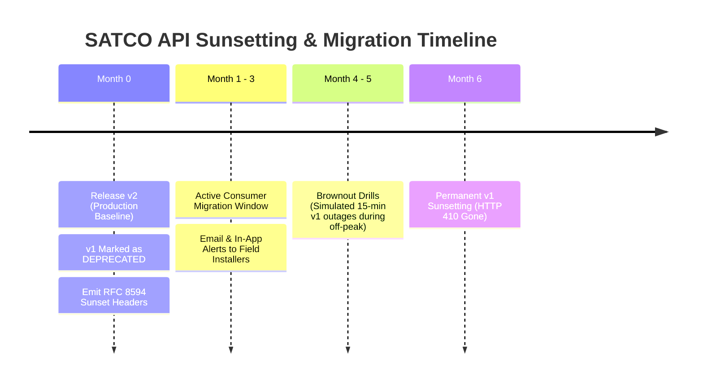
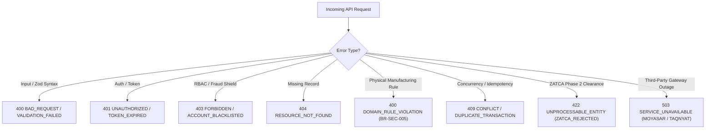
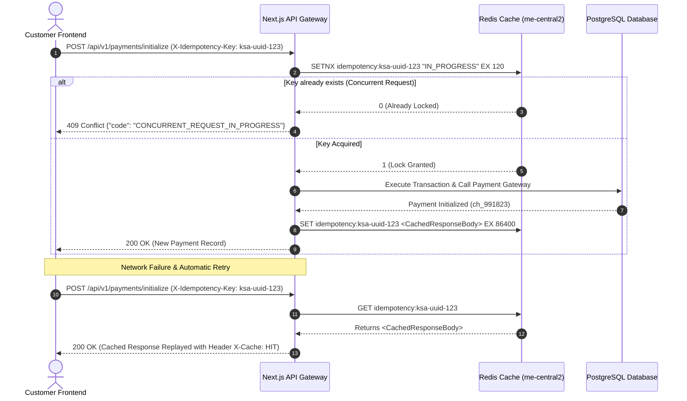

# SATCO AI Smart Furniture Platform
## Enterprise REST API Specification & Endpoint Contracts

**Document Title:** Enterprise REST API Specification  
**File Path:** `src/Api-spac.md`  
**System Name:** SATCO AI Smart Furniture Platform  
**Target Market:** Kingdom of Saudi Arabia (Riyadh, Dammam, Jeddah)  
**API Baseline Version:** `v1` (`/api/v1`)  
**Specification Standard:** OpenAPI 3.1 / RESTful JSON  
**Security Standard:** Bearer JWT, HMAC-SHA256 Signatures, API Key Bridge, ZATCA Phase 2 Compliance  
**Date:** November 2026  
**Status:** Approved for Development  

---

## 1. Global API Standards & Conventions

### 1.1 Base URL & Content Negotiation
- **Development Base URL:** `http://localhost:3000/api/v1`
- **Production Base URL:** `https://api.satco.sa/api/v1`
- **Content-Type:** `application/json; charset=utf-8` (Except binary file streaming for `.mpr` and PDF).
- **Default Locale Header:** `Accept-Language: ar-SA` (fallback to `en-US`).

### 1.2 Global Request Headers
| Header Name | Type | Required | Description |
| :--- | :--- | :--- | :--- |
| `Authorization` | String | Yes (Protected) | `Bearer <JWT_ACCESS_TOKEN>` |
| `X-Idempotency-Key` | UUID v4 | Conditional | Mandatory on all financial payment & checkout endpoints |
| `X-Bridge-Key` | String | Conditional | Mandatory for Homag CNC Factory Bridge daemon (`/cnc-bridge/*`) |
| `Accept-Language` | String | Optional | `ar` (Arabic - Default), `en` (English) |

### 1.3 Global Response Envelope
All API endpoints (except binary streams) strictly return a normalized JSON envelope:

#### Standard Success Response (`200 OK`, `201 Created`):
```json
{
  "success": true,
  "code": "OK",
  "message": "Operation completed successfully.",
  "data": {},
  "meta": {
    "requestId": "req_8f1d2e3c",
    "timestamp": "2026-11-26T09:05:00.000Z"
  }
}
```

#### Standard Error Response (`400`, `401`, `403`, `404`, `422`, `500`):
```json
{
  "success": false,
  "code": "VALIDATION_FAILED",
  "message": "One or more input fields failed validation.",
  "errors": [
    {
      "field": "phoneNumber",
      "rule": "SAUDI_MOBILE_REGEX",
      "message": "Phone number must be a valid Saudi mobile format starting with 05 or +9665."
    }
  ],
  "meta": {
    "requestId": "req_8f1d2e3c",
    "timestamp": "2026-11-26T09:05:00.000Z"
  }
}
```

---

## 2. Authentication & Authorization Matrix

| Role Identifier | Scope & Capabilities |
| :--- | :--- |
| **`PUBLIC`** | Unauthenticated visitors. Can browse templates, materials, calculate quotes, and request OTP. |
| **`CUSTOMER`** | Verified Saudi consumer. Can manage cart, place orders, make payments, sign handovers, and submit reviews. |
| **`INSTALLER_TECHNICIAN`** | In-house field installation crew. Can view assigned installations, update arrival status, and submit customer e-signatures. |
| **`ESTIMATOR` / `DESIGNER`** | Internal sales & technical design team. Can adjust engineering parameters and apply discounts up to their admin-defined `User.maxDiscountPercent` (default ≤ 5%). |
| **`FACTORY_MANAGER`** | Workshop supervisor. Can trigger nesting jobs, release BOMs, manage CNC queues, and approve discounts up to their admin-defined `User.maxDiscountPercent` (default ≤ 15%). |
| **`SUPER_ADMIN`** | Executive leadership. Can configure rate cards, define staff `maxDiscountPercent` (hard ceiling 50%), manage blacklist, view BI analytics, and override discounts. |
| **`HOMAG_BRIDGE_DAEMON`** | Authenticated factory local PC daemon connecting to workshop CNC center. |

---

## 3. API Module Breakdown & Detailed Endpoint Specifications

```
├── 1. Authentication & Identity (/api/v1/auth)
├── 2. Customer 3D Configurator & Catalog (/api/v1/configurator)
├── 3. Shopping Cart & Sample Swatch Box (/api/v1/cart, /api/v1/sample-box)
├── 4. Orders & 3-Tier Milestone Payments (/api/v1/orders, /api/v1/payments)
├── 5. Automated BOM Generation & Nesting (/api/v1/manufacturing)
├── 6. Homag Industrial CNC Machine Bridge (/api/v1/cnc-bridge)
├── 7. ZATCA Phase 2 e-Invoicing (/api/v1/invoices)
├── 8. Field Installation PWA & E-Handover (/api/v1/installations)
└── 9. Admin, Due Manager & Fraud Shield (/api/v1/admin)
```

---

### Module 1: Authentication & Identity Management (`/api/v1/auth`)

#### 1.1 Request Saudi SMS OTP
- **Endpoint:** `POST /api/v1/auth/otp/request`
- **Method:** `POST`
- **Authentication:** `PUBLIC`
- **Description:** Sends a 4-digit SMS OTP via Taqnyat/Unifonic to a Saudi mobile number (`+9665xxxxxxxx`). Rate-limited to 3 requests per 10 minutes.
- **Request Body:**
```json
{
  "phoneNumber": "0501234567"
}
```
- **Validation Rules:**
  - `phoneNumber`: Must match regex `^(?:\+966|00966|0)?5[0-9]{8}$`.
- **Response (`200 OK`):**
```json
{
  "success": true,
  "code": "OTP_SENT",
  "message": "OTP verification code sent to +966501234567.",
  "data": {
    "normalizedPhone": "+966501234567",
    "expiresInSeconds": 180,
    "resendAvailableInSeconds": 60
  }
}
```

#### 1.2 Verify SMS OTP & Authenticate
- **Endpoint:** `POST /api/v1/auth/otp/verify`
- **Method:** `POST`
- **Authentication:** `PUBLIC`
- **Description:** Verifies the 4-digit OTP. Checks fraud blacklist (`BR-SEC-001`). Creates customer profile if first-time user and returns Bearer JWT.
- **Request Body:**
```json
{
  "phoneNumber": "+966501234567",
  "otpCode": "4892"
}
```
- **Response (`200 OK`):**
```json
{
  "success": true,
  "code": "AUTH_SUCCESS",
  "message": "Authenticated successfully.",
  "data": {
    "accessToken": "eyJhbGciOiJIUzI1NiIsInR5cCI6IkpXVCJ9...",
    "tokenType": "Bearer",
    "expiresIn": 604800,
    "user": {
      "id": "e3b0c442-98fc-1c14-9af0-2a3b4c5d6e7f",
      "phone": "+966501234567",
      "fullName": "Faisal Al-Otaibi",
      "role": "CUSTOMER",
      "preferredLocale": "ar"
    }
  }
}
```
- **Error Response (`403 Forbidden - Blacklisted`):**
```json
{
  "success": false,
  "code": "ACCOUNT_BLACKLISTED",
  "message": "This mobile number has been suspended due to security or fraud violations."
}
```

#### 1.3 Staff Email/Password Login
- **Endpoint:** `POST /api/v1/auth/staff/login`
- **Method:** `POST`
- **Authentication:** `PUBLIC`
- **Description:** Authenticates internal employees (Admins, Factory Managers, Estimators, Installers).
- **Request Body:**
```json
{
  "email": "operations@satco.sa",
  "password": "SecurePassword123!"
}
```
- **Response (`200 OK`):**
```json
{
  "success": true,
  "code": "STAFF_AUTH_SUCCESS",
  "data": {
    "accessToken": "eyJhbGciOiJIUzI1NiIsInR5cCI6IkpXVCJ9...",
    "user": {
      "id": "9b1deb4d-3b7d-4bad-9bdd-2b0d7b3dcb6d",
      "email": "operations@satco.sa",
      "fullName": "Tariq Al-Otaibi",
      "role": "SUPER_ADMIN"
    }
  }
}
```

---

### Module 2: Customer 3D Configurator & Catalog (`/api/v1/configurator`)

#### 2.1 List Product Templates
- **Endpoint:** `GET /api/v1/configurator/templates`
- **Method:** `GET`
- **Authentication:** `PUBLIC`
- **Query Parameters:** `category` (optional), `page` (default 1), `limit` (default 20).
- **Response (`200 OK`):**
```json
{
  "success": true,
  "data": {
    "templates": [
      {
        "id": "c1a2b3c4-d5e6-7890-abcd-ef1234567890",
        "slug": "luxury-2door-wardrobe",
        "nameAr": "خزانة ملابس مودرن درفتين مخصصة",
        "nameEn": "Luxury 2-Door Custom Modular Wardrobe",
        "minWidthMm": 800,
        "maxWidthMm": 2400,
        "minHeightMm": 1800,
        "maxHeightMm": 3000,
        "minDepthMm": 450,
        "maxDepthMm": 750,
        "defaultWidthMm": 1200,
        "defaultHeightMm": 2400,
        "defaultDepthMm": 600,
        "basePriceSar": "1850.0000"
      }
    ]
  }
}
```

#### 2.2 Get Active Materials & Finishes Catalog
- **Endpoint:** `GET /api/v1/configurator/materials`
- **Method:** `GET`
- **Authentication:** `PUBLIC`
- **Description:** Returns active Egger MFC/MDF sheets, Rehau edge-bandings, and Blum hardware items.
- **Response (`200 OK`):**
```json
{
  "success": true,
  "data": {
    "materialSheets": [
      {
        "code": "EGG-H1180-ST37",
        "brand": "Egger",
        "nameAr": "خشب إيجر هاليفاكس أوك طبيعي 18 ملم",
        "nameEn": "Egger Natural Halifax Oak 18mm MFC",
        "thicknessMm": "18.00",
        "sellingPricePerSqmSar": "125.0000",
        "textureUrl": "https://satco-assets.sa/textures/egg-h1180.jpg",
        "roughness": 0.35,
        "inStock": true
      }
    ],
    "edgeBandings": [
      {
        "code": "REHAU-H1180-22X1",
        "materialType": "ABS",
        "thicknessMm": "1.00",
        "widthMm": "22.00",
        "sellingPricePerMeterSar": "3.5000"
      }
    ]
  }
}
```

#### 2.3 Real-Time Parametric Pricing Calculation Engine
- **Endpoint:** `POST /api/v1/configurator/calculate-price`
- **Method:** `POST`
- **Authentication:** `PUBLIC`
- **Description:** Executes `PricingEngineService` with `decimal.js`. Enforces `BR-PRICE-001`, `BR-PRICE-002`, and ZATCA 15% VAT.
- **Request Body:**
```json
{
  "templateId": "c1a2b3c4-d5e6-7890-abcd-ef1234567890",
  "widthMm": 1600,
  "heightMm": 2400,
  "depthMm": 600,
  "carcassMaterialCode": "EGG-H1180-ST37",
  "shutterMaterialCode": "EGG-W1000-PM",
  "edgeBandingCode": "REHAU-H1180-22X1",
  "shelvesCount": 4,
  "drawersCount": 2,
  "doorsCount": 2,
  "hasLighting": false,
  "hasSoftClose": true
}
```
- **Response (`200 OK`):**
```json
{
  "success": true,
  "data": {
    "breakdown": {
      "rawMaterialCostSar": "2184.2000",
      "edgeBandingCostSar": "112.5000",
      "hardwareCostSar": "478.0000",
      "cuttingLaborSar": "84.2000",
      "cncMachiningLaborSar": "36.8000",
      "factoryLaborMarkupSar": "521.2260",
      "grossMarginSar": "751.7677"
    },
    "totals": {
      "netSubtotalSar": "4168.69",
      "discountSar": "0.00",
      "vatPercentage": "15.00",
      "vatAmountSar": "625.30",
      "grandTotalSar": "4793.99"
    },
    "milestones": {
      "milestone1Deposit50": "2397.00",
      "milestone2PreDispatch40": "1917.60",
      "milestone3Handover10": "479.39"
    }
  }
}
```

---

### Module 3: Shopping Cart & Sample Box (`/api/v1/cart`, `/api/v1/sample-box`)

#### 3.1 Get Active Cart
- **Endpoint:** `GET /api/v1/cart`
- **Method:** `GET`
- **Authentication:** `PUBLIC` (with Session-ID) or `CUSTOMER`
- **Headers:** `X-Session-ID: <session_uuid>`
- **Response (`200 OK`):**
```json
{
  "success": true,
  "data": {
    "cartId": "f7d3a2b1-1234-5678-9abc-def012345678",
    "totalItems": 1,
    "netSubtotalSar": "4168.69",
    "vatAmountSar": "625.30",
    "grandTotalSar": "4793.99",
    "items": [
      {
        "id": "item_98234",
        "templateSlug": "luxury-2door-wardrobe",
        "titleAr": "خزانة ملابس مودرن درفتين مخصصة",
        "configuredDimensions": {
          "widthMm": 1600,
          "heightMm": 2400,
          "depthMm": 600
        },
        "quantity": 1,
        "unitPriceSar": "4793.99",
        "totalPriceSar": "4793.99"
      }
    ]
  }
}
```

#### 3.2 Add Configured Item to Cart
- **Endpoint:** `POST /api/v1/cart/items`
- **Method:** `POST`
- **Authentication:** `PUBLIC` / `CUSTOMER`
- **Request Body:**
```json
{
  "templateId": "c1a2b3c4-d5e6-7890-abcd-ef1234567890",
  "configuredWidthMm": 1600,
  "configuredHeightMm": 2400,
  "configuredDepthMm": 600,
  "configurationJson": {
    "carcass": "EGG-H1180-ST37",
    "shutter": "EGG-W1000-PM",
    "shelves": 4,
    "drawers": 2
  },
  "quantity": 1
}
```
- **Response (`201 Created`):**
```json
{
  "success": true,
  "code": "ITEM_ADDED_TO_CART",
  "message": "Configured furniture added to cart."
}
```

#### 3.3 Order Material Sample Box (100 SAR Refundable)
- **Endpoint:** `POST /api/v1/sample-box/order`
- **Method:** `POST`
- **Authentication:** `CUSTOMER`
- **Description:** Orders a physical wood swatch box. Fee is 100 SAR, automatically credited toward subsequent custom furniture orders.
- **Request Body:**
```json
{
  "shippingAddress": {
    "buildingNumber": "3244",
    "streetName": "King Fahd Road",
    "district": "Al Olaya",
    "city": "Riyadh",
    "postalCode": "12211"
  },
  "preferredFinishes": ["EGG-H1180-ST37", "EGG-W1000-PM", "EGG-U708-ST9"]
}
```
- **Response (`201 Created`):**
```json
{
  "success": true,
  "code": "SAMPLE_BOX_ORDERED",
  "data": {
    "sampleBoxOrderId": "box_991823",
    "feeSar": "100.00",
    "creditPolicy": "100.00 SAR will be automatically deducted from your first furniture order exceeding 2,000 SAR.",
    "status": "ORDERED"
  }
}
```

---

### Module 4: Orders & Milestone Payment Ledger (`/api/v1/orders`, `/api/v1/payments`)

#### 4.1 Checkout Order (Create Binding Sales Contract)
- **Endpoint:** `POST /api/v1/orders/checkout`
- **Method:** `POST`
- **Authentication:** `CUSTOMER`
- **Headers:** `X-Idempotency-Key: <uuid-v4>`
- **Description:** Converts cart into a binding Order (`STATUS: PENDING_DEPOSIT`). Configures warranty (1 or 2 years) and generates Milestone 1 invoice.
- **Request Body:**
```json
{
  "cartId": "f7d3a2b1-1234-5678-9abc-def012345678",
  "addressId": "addr_991283",
  "warrantyYears": 2,
  "appliedCouponCode": "RIYADH2026",
  "customerNotes": "Please call before arrival for installation site clearance."
}
```
- **Response (`201 Created`):**
```json
{
  "success": true,
  "code": "ORDER_CREATED",
  "data": {
    "orderId": "ord_882910a",
    "orderNumber": "ORD-2026-00452",
    "status": "PENDING_DEPOSIT",
    "netSubtotalSar": "4168.69",
    "vatAmountSar": "625.30",
    "grandTotalSar": "4793.99",
    "depositRequiredSar": "2397.00",
    "warrantyYears": 2,
    "milestones": [
      {
        "milestone": "MILESTONE_1_DEPOSIT",
        "percentage": 50,
        "amountSar": "2397.00",
        "status": "PENDING",
        "description": "50% Commitment Deposit required to start CNC manufacturing"
      },
      {
        "milestone": "MILESTONE_2_PRE_DISPATCH",
        "percentage": 40,
        "amountSar": "1917.60",
        "status": "PENDING",
        "description": "40% Pre-Dispatch Balance required before factory truck departs"
      },
      {
        "milestone": "MILESTONE_3_HANDOVER",
        "percentage": 10,
        "amountSar": "479.39",
        "status": "PENDING",
        "description": "10% Final Balance collected on site upon digital e-signature"
      }
    ]
  }
}
```

#### 4.2 Initialize Milestone Payment (Mada / Apple Pay / Tabby)
- **Endpoint:** `POST /api/v1/payments/initialize`
- **Method:** `POST`
- **Authentication:** `CUSTOMER`
- **Headers:** `X-Idempotency-Key: <uuid-v4>`
- **Request Body:**
```json
{
  "orderId": "ord_882910a",
  "milestone": "MILESTONE_1_DEPOSIT",
  "paymentMethod": "MADA",
  "callbackUrl": "https://satco.sa/orders/ord_882910a/payment-return"
}
```
- **Response (`200 OK`):**
```json
{
  "success": true,
  "data": {
    "transactionId": "tx_772819",
    "gatewayReference": "moyasar_ch_991823",
    "amountSar": "2397.00",
    "checkoutUrl": "https://api.moyasar.com/v1/checkouts/ch_991823"
  }
}
```

#### 4.3 Payment Gateway Webhook (Moyasar / Tamara)
- **Endpoint:** `POST /api/v1/payments/webhook`
- **Method:** `POST`
- **Authentication:** `HMAC-SHA256 Signature` (`X-Signature: ...`)
- **Description:** Idempotent webhook handler. On Milestone 1 verification: changes order status to `PAID_DEPOSIT`, releasing `BR-SEC-005` (allows saw cuts). On Milestone 2: unlocks dispatch hold (`BR-ORD-005`).
- **Response (`200 OK`):**
```json
{
  "received": true,
  "processed": true
}
```

---

### Module 5: Automated BOM & Nesting Engine (`/api/v1/manufacturing`)

#### 5.1 Generate Order BOM Cutting List
- **Endpoint:** `POST /api/v1/manufacturing/orders/:orderId/generate-bom`
- **Method:** `POST`
- **Authentication:** `STAFF` (`FACTORY_MANAGER`, `SUPER_ADMIN`)
- **Description:** Computes exact panel sizes, grain direction, edge tape codes, and generates opaque UUID tokens for scannable barcode travelers (protects customer PII under Saudi PDPL).
- **Response (`200 OK`):**
```json
{
  "success": true,
  "data": {
    "orderId": "ord_882910a",
    "totalPartsCount": 18,
    "bomItems": [
      {
        "id": "bom_101",
        "partLabel": "GABLE_LEFT_01",
        "barcodeOpaqueToken": "a1b2c3d4-e5f6-7890-abcd-ef1234567890",
        "materialCode": "EGG-H1180-ST37",
        "cutLengthMm": 2396.00,
        "cutWidthMm": 596.00,
        "thicknessMm": 18.00,
        "grainDirection": "LENGTHWISE",
        "edgeBanding": {
          "top": false,
          "bottom": false,
          "left": true,
          "right": true
        }
      }
    ]
  }
}
```

#### 5.2 Execute Guillotine-2D Nesting Optimization
- **Endpoint:** `POST /api/v1/manufacturing/jobs/nest`
- **Method:** `POST`
- **Authentication:** `STAFF` (`FACTORY_MANAGER`)
- **Description:** Takes BOM panel list, runs 2D Guillotine rectangular packing against $2440 \times 1220\text{ mm}$ raw sheets, computes scrap waste %, and records job.
- **Request Body:**
```json
{
  "orderId": "ord_882910a",
  "sheetMaterialId": "mat_egger_oak_18mm",
  "bladeKerfMm": 4.5,
  "trimMarginMm": 10.0
}
```
- **Response (`200 OK`):**
```json
{
  "success": true,
  "data": {
    "cuttingJobId": "cut_991823",
    "totalSheetsUsed": 4,
    "efficiencyRate": "0.9120",
    "wastePercentage": "0.0880",
    "totalScrapSqm": "1.047",
    "status": "NESTED"
  }
}
```

---

### Module 6: Homag Industrial CNC Bridge (`/api/v1/cnc-bridge`)

#### 6.1 Poll Queued CNC Jobs (Factory Bridge Daemon)
- **Endpoint:** `GET /api/v1/cnc-bridge/poll`
- **Method:** `GET`
- **Authentication:** `X-Bridge-Key: <FACTORY_BRIDGE_API_KEY>`
- **Description:** Workshop local PC daemon long-polls every 5 seconds over local LAN to fetch cutting programs waiting for Homag Centateq/Sawteq machining centers.
- **Response (`200 OK`):**
```json
{
  "success": true,
  "data": {
    "pendingJobs": [
      {
        "cncJobId": "cnc_882910",
        "cuttingJobId": "cut_991823",
        "machineModel": "Homag Centateq / Sawteq",
        "programNumber": "SATCO_PRG_452_01",
        "sheetIndex": 1,
        "downloadUrl": "/api/v1/cnc-bridge/jobs/cnc_882910/program"
      }
    ]
  }
}
```

#### 6.2 Stream woodWOP / MPR / Layered DXF Binary File
- **Endpoint:** `GET /api/v1/cnc-bridge/jobs/:jobId/program`
- **Method:** `GET`
- **Authentication:** `X-Bridge-Key: <FACTORY_BRIDGE_API_KEY>`
- **Response:** Raw binary file with `Content-Type: application/octet-stream`, `Content-Disposition: attachment; filename="SATCO_PRG_452_01.mpr"`.

#### 6.3 Report Machine Execution Status
- **Endpoint:** `POST /api/v1/cnc-bridge/jobs/:jobId/status`
- **Method:** `POST`
- **Authentication:** `X-Bridge-Key: <FACTORY_BRIDGE_API_KEY>`
- **Request Body:**
```json
{
  "status": "COMPLETED",
  "executionDurationSeconds": 314,
  "cycleCount": 1,
  "errorLog": null
}
```
- **Response (`200 OK`):**
```json
{
  "success": true,
  "code": "STATUS_ACKNOWLEDGED"
}
```

---

### Module 7: ZATCA Phase 2 e-Invoicing (`/api/v1/invoices`)

#### 7.1 Issue Tax Invoice & Generate TLV QR Code
- **Endpoint:** `POST /api/v1/invoices/:orderId/issue`
- **Method:** `POST`
- **Authentication:** `STAFF` (`SUPER_ADMIN`, `FACTORY_MANAGER`)
- **Description:** Generates ZATCA Phase 2 compliant e-invoice. Calculates cryptographic SHA-256 hash chain, creates 8-tag Base64 TLV QR code string, and submits to ZATCA Fatoora API.
- **Response (`201 Created`):**
```json
{
  "success": true,
  "data": {
    "invoiceId": "inv_991823",
    "invoiceNumber": "INV-2026-00452",
    "invoiceType": "SIMPLIFIED_TAX_INVOICE",
    "subtotalSar": "4168.69",
    "vatAmountSar": "625.30",
    "totalWithVatSar": "4793.99",
    "zatcaUuid": "3fa85f64-5717-4562-b3fc-2c963f66afa6",
    "zatcaTlvQrBase64": "AQxTQVRDTyBDbyBMdGQCEzMxMDI5NDg1NzIwMDAwMxMUMjAyNi0xMS0yNlQwOTowNTowMFoEBjQ3OTMuOTkFBjYyNS4zMA==",
    "status": "CLEARED_BY_ZATCA"
  }
}
```

#### 7.2 Download Official ZATCA PDF Tax Invoice
- **Endpoint:** `GET /api/v1/invoices/:invoiceId/pdf`
- **Method:** `GET`
- **Authentication:** `CUSTOMER` (Owner) or `STAFF`
- **Response:** Streaming PDF (`Content-Type: application/pdf`).

---

### Module 8: Field Installation PWA & E-Handover (`/api/v1/installations`)

#### 8.1 List Assigned Daily Jobs (Installer Tablet)
- **Endpoint:** `GET /api/v1/installations/assigned`
- **Method:** `GET`
- **Authentication:** `STAFF` (`INSTALLER_TECHNICIAN`)
- **Response (`200 OK`):**
```json
{
  "success": true,
  "data": {
    "jobs": [
      {
        "installationJobId": "inst_101928",
        "orderNumber": "ORD-2026-00452",
        "customerName": "Faisal Al-Otaibi",
        "customerPhone": "+966501234567",
        "scheduledDate": "2026-11-28",
        "timeSlot": "09:00 - 13:00",
        "district": "Al Olaya, Riyadh",
        "buildingNumber": "3244",
        "status": "SCHEDULED"
      }
    ]
  }
}
```

#### 8.2 Submit Digital Handover & Customer E-Signature
- **Endpoint:** `POST /api/v1/installations/:jobId/complete`
- **Method:** `POST`
- **Authentication:** `STAFF` (`INSTALLER_TECHNICIAN`)
- **Description:** Technicians submit completed installation photos, customer digital e-signature data URL, and GPS coordinates. Automatically unlocks Milestone 3 payment collection (`BR-INS-001`).
- **Request Body:**
```json
{
  "customerSignDataUrl": "data:image/png;base64,iVBORw0KGgoAAAANSUhEUgAA...",
  "completionPhotos": [
    "https://storage.googleapis.com/satco-furniture-production/inst/photo1.jpg",
    "https://storage.googleapis.com/satco-furniture-production/inst/photo2.jpg"
  ],
  "latitude": 24.7136,
  "longitude": 46.6753,
  "technicianNotes": "Cabinet leveled, soft-close hinges calibrated. Customer approved."
}
```
- **Response (`200 OK`):**
```json
{
  "success": true,
  "code": "HANDOVER_COMPLETED",
  "data": {
    "orderStatus": "HANDOVER_COMPLETED",
    "finalHandoverDueSar": "479.39",
    "warrantyCardIssued": true,
    "warrantyValidUntil": "2028-11-28T09:00:00Z"
  }
}
```

---

### Module 9: Admin, Due Manager & Fraud Shield (`/api/v1/admin`)

#### 9.1 Accounts Receivable Aging Report (Due Manager)
- **Endpoint:** `GET /api/v1/admin/due-manager/aging`
- **Method:** `GET`
- **Authentication:** `STAFF` (`SUPER_ADMIN`, `FACTORY_MANAGER`)
- **Response (`200 OK`):**
```json
{
  "success": true,
  "data": {
    "totalOverdueSar": "184500.00",
    "buckets": {
      "currentUnder30Days": {
        "count": 14,
        "totalDueSar": "92400.00"
      },
      "aging31To60Days": {
        "count": 6,
        "totalDueSar": "54100.00"
      },
      "aging61To90Days": {
        "count": 2,
        "totalDueSar": "19500.00"
      },
      "agingOver90Days": {
        "count": 3,
        "totalDueSar": "38000.00"
      }
    }
  }
}
```

#### 9.2 Add Number to Fraud Blacklist
- **Endpoint:** `POST /api/v1/admin/fraud/blacklist`
- **Method:** `POST`
- **Authentication:** `STAFF` (`SUPER_ADMIN`)
- **Request Body:**
```json
{
  "phone": "+966555999888",
  "reason": "REPEATED_FAKE_ORDERS",
  "notes": "Repeatedly ordered custom panels with fake COD requests."
}
```
- **Response (`201 Created`):**
```json
{
  "success": true,
  "code": "BLACKLIST_ADDED",
  "message": "+966555999888 blocked from placing orders."
}
```

---

## 4. API Version Control & Deprecation Strategy

To ensure zero-downtime operations across customer web configurators, offline field installer PWAs, and local workshop PC daemons (Homag CNC Bridge), SATCO enforces a strict, predictable API versioning and deprecation governance model.

### 4.1 URI Path Versioning Baseline
All REST APIs use explicit URI path versioning:
- **Baseline URI Pattern:** `https://api.satco.sa/api/v{major}/...`
- **Current Active Version:** `/api/v1`
- **Future Version Branching:** `/api/v2`

```
Next.js 15 Route Architecture:
src/app/api/
├── v1/
│   ├── auth/
│   ├── configurator/
│   ├── cart/
│   ├── orders/
│   ├── manufacturing/
│   ├── cnc-bridge/
│   ├── invoices/
│   └── installations/
└── v2/ (Staged for breaking schema changes)
```

### 4.2 Semantic Versioning & Compatibility Rules
SATCO adheres to Semantic Versioning (`MAJOR.MINOR.PATCH`) applied to API contracts:

1. **Non-Breaking Changes (Same Version - `v1`):**
   - Adding new optional query parameters.
   - Adding new fields to an existing JSON response payload.
   - Adding completely new endpoints or resources.
   - Internal performance optimizations and bug fixes.
   - *Requirement:* All client applications (Three.js frontend, PWA) MUST ignore unknown JSON fields (permissive deserialization).

2. **Breaking Changes (Requires New Major Version - `v2`):**
   - Renaming or removing existing fields from request bodies or responses.
   - Changing the data type of an existing field (e.g., string to object, or integer to array).
   - Changing authentication mechanisms or required headers.
   - Modifying core pricing mathematical algorithms or rounding modes.
   - Altering order state machine transition rules.

### 4.3 Deprecation Policy & Sunsetting Lifecycle
When a breaking major version (`v2`) is introduced, the legacy version (`v1`) enters a formal **6-Month Sunsetting Lifecycle**:



#### RFC 8594 Standard Deprecation Response Headers:
When a client queries a deprecated API version, the server injects standard metadata headers:
```http
HTTP/1.1 200 OK
Deprecation: @1774915200
Sunset: Wed, 30 Jun 2027 23:59:59 GMT
Link: <https://api.satco.sa/docs/v2/migration-guide>; rel="sunset"
X-API-Warn: "API v1 is deprecated and will be decommissioned on 2027-06-30. Please migrate to v2."
```

### 4.4 Hardware Daemon & Factory Bridge Version Negotiation
Because the Homag CNC Bridge runs as an on-premise background daemon in the Riyadh factory:
- The daemon sends its local software version on every poll: `X-Bridge-Protocol-Version: 1.2.0`.
- If the cloud platform introduces a breaking change to `.mpr` generation or job schema:
  - The server responds with `HTTP 426 Upgrade Required`.
  - Body returns:
  ```json
  {
    "success": false,
    "code": "BRIDGE_UPGRADE_REQUIRED",
    "message": "Factory PC Bridge version 1.2.0 is incompatible. Minimum required version is 2.0.0.",
    "data": {
      "minimumVersion": "2.0.0",
      "downloadUrl": "https://satco-assets.sa/binaries/satco-bridge-v2.0.0-windows-x64.exe"
    }
  }
  ```

---

## 5. Enterprise Error Handling & Resilience Architecture

The SATCO platform implements a defensive, centralized error handling strategy based on **RFC 7807 (Problem Details for HTTP APIs)**, extended with SATCO enterprise metadata, audit tracing, and Saudi PDPL data redaction.

### 5.1 Global Error Taxonomy & Classification



### 5.2 Unified RFC 7807 Extended Error Envelope
Every non-2xx response adheres strictly to this structure:

```json
{
  "success": false,
  "type": "https://api.satco.sa/docs/errors/SAW_CUT_BLOCKED_NO_DEPOSIT",
  "code": "SAW_CUT_BLOCKED_NO_DEPOSIT",
  "title": "Manufacturing Saw Cut Blocked",
  "status": 400,
  "message": "Physical saw cutting cannot proceed because the 50% commitment deposit has not been confirmed.",
  "errors": [
    {
      "field": "orderId",
      "rule": "BR-SEC-005",
      "message": "Order ORD-2026-00452 has paidAmountSar: 0.0000. Minimum required: 2397.0000 SAR."
    }
  ],
  "meta": {
    "requestId": "req_ksa_98f12a3b",
    "timestamp": "2026-11-26T09:08:00.000Z",
    "documentationUrl": "https://api.satco.sa/docs/business-rules#BR-SEC-005"
  }
}
```

### 5.3 Complete HTTP Status Code & Error Registry

| HTTP Status | SATCO Error Code | Exact Trigger Condition |
| :--- | :--- | :--- |
| **`400 Bad Request`** | `VALIDATION_FAILED` | Input payload failed Zod schema parsing (e.g. invalid dimensions, negative quantity). |
| **`400 Bad Request`** | `SAW_CUT_BLOCKED_NO_DEPOSIT` | CNC cutting or wood sheet pull attempted before Milestone 1 deposit cleared (`BR-SEC-005`). |
| **`400 Bad Request`** | `DISPATCH_HOLD_UNPAID_MILESTONE` | Delivery truck dispatch manifest attempted while Milestone 2 is unpaid (`BR-ORD-005`). |
| **`400 Bad Request`** | `INVALID_DIMENSION_LIMITS` | Configured cabinet dimensions fall outside template minimum/maximum boundaries. |
| **`401 Unauthorized`**| `INVALID_CREDENTIALS` | Incorrect staff password or invalid customer SMS OTP. |
| **`401 Unauthorized`**| `TOKEN_EXPIRED` | Bearer JWT access token has expired (client must call `/auth/refresh`). |
| **`401 Unauthorized`**| `INVALID_BRIDGE_KEY` | Factory PC Bridge daemon provided an invalid or revoked `X-Bridge-Key`. |
| **`403 Forbidden`**   | `ACCOUNT_BLACKLISTED` | Mobile number or device fingerprint matched in fraud shield blacklist (`BR-SEC-001`). |
| **`403 Forbidden`**   | `DISCOUNT_CEILING_EXCEEDED`| Requested discount exceeds authorized staff threshold without supervisor approval (`BR-PRICE-004`). |
| **`403 Forbidden`**   | `INSUFFICIENT_ROLE_PERMISSIONS`| User role cannot perform this action (e.g., installer attempting to release CNC jobs). |
| **`404 Not Found`**   | `ORDER_NOT_FOUND` | Specified order ID does not exist in the company realm. |
| **`404 Not Found`**   | `TEMPLATE_NOT_FOUND` | Product template slug is inactive or does not exist. |
| **`409 Conflict`**    | `IDEMPOTENCY_KEY_REPLAY_ACTIVE` | Duplicate request in-flight with identical `X-Idempotency-Key` (prevents double charges). |
| **`409 Conflict`**    | `STATE_MACHINE_TRANSITION_INVALID`| Attempted illegal order transition (e.g. moving from `DRAFT` directly to `IN_PRODUCTION`). |
| **`422 Unprocessable`**| `ZATCA_INVOICE_HASH_MISMATCH`| Cryptographic invoice hash chain failed ZATCA Phase 2 validation checks. |
| **`422 Unprocessable`**| `NESTING_SURFACE_OVERFLOW` | Total part area exceeds raw sheet boundary constraints or grain direction lock. |
| **`429 Too Many Req`**| `RATE_LIMIT_EXCEEDED` | Exceeded 3 SMS OTP requests in 10 minutes, or 100 pricing requests per minute. |
| **`502 Bad Gateway`** | `PAYMENT_GATEWAY_TIMEOUT` | Moyasar, Apple Pay, or Tabby upstream API timed out (>15s). |
| **`503 Unavailable`** | `SMS_GATEWAY_UNAVAILABLE` | Local telecom SMS aggregator (Taqnyat/Unifonic) is experiencing service disruption. |
| **`504 Gateway Timeout`**| `ZATCA_PORTAL_TIMEOUT` | ZATCA Fatoora clearance API did not respond within timeout window. |

---

### 5.4 Idempotency & Financial Double-Charge Shield

All state-mutating financial and checkout endpoints (`/orders/checkout`, `/payments/initialize`) require the `X-Idempotency-Key: <UUID>` header.



### 5.5 Upstream Resilience & Retry Backoff Patterns
For third-party integrations (Moyasar Payment Gateway, Taqnyat SMS, and ZATCA Fatoora API):

1. **Exponential Backoff with Full Jitter:**
   Whenever a transient network error (`ECONNRESET`, `ETIMEDOUT`, `503`) occurs:
   $$\text{Sleep Time} = \text{random}(0, \min(M, T_0 \cdot 2^{\text{attempt}}))$$
   - Base delay $T_0 = 500\text{ ms}$
   - Maximum delay $M = 8000\text{ ms}$
   - Maximum retry attempts: 3

2. **ZATCA Offline Asynchronous Resilience Mode:**
   If the ZATCA government portal is offline or returns `503`:
   - The platform switches to **Offline Compliant Signing**.
   - The invoice XML is signed with the local private key and stored as `REPORTED_TO_ZATCA_PENDING`.
   - Customer checkout is NOT blocked.
   - A BullMQ background worker retries clearance every 15 minutes until cleared.

### 5.6 Saudi PDPL Privacy & Security Log Redaction
Under the Saudi Personal Data Protection Law (Royal Decree M/19), raw stack traces and customer Personally Identifiable Information (PII) MUST NEVER be logged or leaked:
- **Production Masking:** When `NODE_ENV === 'production'`, internal exception stack traces are suppressed from client responses.
- **Log Scrubber Filter:** The logging interceptor automatically sanitizes:
  - Mobile numbers $\rightarrow$ Masked as `+9665****4567`
  - National IDs / Iqamas $\rightarrow$ Masked as `1010****89`
  - Credit Card / Mada numbers $\rightarrow$ Tokenized / Masked to last 4 digits
  - Passwords & OTPs $\rightarrow$ Stripped completely (`[REDACTED]`)
- **Correlation ID:** Every error logs a unique `traceId` / `requestId`, allowing support engineers to inspect masked logs in Datadog/Cloud Logging without compromising user privacy.

---

## 6. Architectural Alignment Verification

This API specification directly satisfies:
1. **`PRD.md`**: All 24 functional modules, in-house installer PWA, 100 SAR sample box, and 1-2 year warranty engine.
2. **`Database.md` & `src/database-schema.md`**: Direct 1:1 mapping with all 25 relational tables and Prisma client models.
3. **`Architecture.md`**: Section 5 API boundary, ZATCA Phase 2 TLV QR, and Homag CNC Factory Bridge daemon contract.
4. **Saudi Regulations**: PDPL customer PII protection (opaque tokens on BOM parts) and ZATCA 15% VAT exactness.

