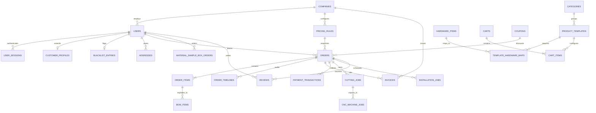

# SATCO AI Smart Furniture Platform
## Implemented Schema Snapshot (`prisma/schema.prisma`)

**Target Location:** `src/database-schema.md`  
**Document Role:** Implemented Schema Snapshot (Executable Source of Truth: `prisma/schema.prisma`; Target Blueprint: `Database.md`; Reconciliation: `docs/ADR-001-SCHEMA-RECONCILIATION.md`)  
**System Name:** SATCO AI Smart Furniture Platform (Riyadh, KSA)  
**Version:** 2.1 (Reconciled 40-Model / 22-Enum Baseline)  
**Status:** Active & Verified with Prisma 5.22.0 (PostgreSQL 15+)

> [!NOTE]
> `prisma/schema.prisma` has been reconciled with `Database.md` to include all 40 models (adding `Enquiry`, `Quotation`, `QuotationItem`, `MilestonePayment`, `ProductionJob`, `ProductionStageLog`, `BOMRevision`, `StockBalance`, `StockMovement`, `MaterialReservation`, `AuditLog`, `HandoverSignature`, and `WarrantyClaim`). See `docs/ADR-001-SCHEMA-RECONCILIATION.md` for full mapping details.

---

## 1. Master Entity-Relationship Diagram (ERD)



---

## 2. Table Registry (27 PostgreSQL Tables via Prisma ORM)

| Entity Name | Primary Purpose | Storage Engine | Key Indexes |
| :--- | :--- | :--- | :--- |
| **`companies`** | Multi-tenant company realms, CR & ZATCA VAT ID | PostgreSQL | `cr_number`, `vat_registration_number` |
| **`users`** | Staff (`password_hash`, `max_discount_percent`) & customers | PostgreSQL | `phone`, `email`, `role` |
| **`user_sessions`** | Secure session tokens & device fingerprints | PostgreSQL | `user_id`, `token_hash` |
| **`customer_profiles`** | Customer identity, Saudi mobile, risk score, PDPL | PostgreSQL | `user_id` |
| **`blacklist_entries`** | Fraud shield & fake-order blacklisted phones | PostgreSQL | `phone`, `user_id` |
| **`addresses`** | Saudi National Address with 4-digit building/zip | PostgreSQL | `user_id` |
| **`categories`** | Furniture taxonomy (Wardrobes, Kitchens, Vanities) | PostgreSQL | `slug` |
| **`material_sheets`** | Egger/Kronospan $2440 \times 1220\text{ mm}$ raw boards | PostgreSQL | `code`, `brand` |
| **`hardware_items`** | Blum/Hafele hinges, soft-close slides, handles | PostgreSQL | `sku` |
| **`edge_bandings`** | Rehau ABS edge-banding reels ($1\text{mm}, 2\text{mm}$) | PostgreSQL | `code` |
| **`product_templates`** | Parametric models with dimension limits ($W, H, D$) | PostgreSQL | `category_id`, `slug` |
| **`template_hardware_maps`** | Joinery hardware formulas per template | PostgreSQL | `template_id`, `hardware_id` |
| **`pricing_rules`** | Immutable versioned rate cards, margins & 15% VAT | PostgreSQL | `company_id`, `effective_from` |
| **`carts`** | Guest & user shopping carts | PostgreSQL | `session_id`, `user_id` |
| **`cart_items`** | Configured parametric items in cart | PostgreSQL | `cart_id` |
| **`orders`** | Binding contracts, payment totals, state machine | PostgreSQL | `order_number`, `customer_id`, `status` |
| **`order_items`** | Line items with parametric JSON snapshot | PostgreSQL | `order_id` |
| **`order_timelines`** | Audit trail of order status transitions | PostgreSQL | `order_id` |
| **`bom_items`** | Manufacturing panel cutting lists & opaque barcodes | PostgreSQL | `order_item_id`, `barcode_opaque_token` |
| **`cutting_jobs`** | Guillotine-2D nesting plans & scrap % | PostgreSQL | `order_id` |
| **`cnc_machine_jobs`** | Homag Centateq/Sawteq woodWOP/MPR job queue | PostgreSQL | `cutting_job_id`, `status` |
| **`invoices`** | ZATCA Phase 2 tax invoices with TLV QR Base64 | PostgreSQL | `invoice_number`, `order_id`, `zatca_uuid` |
| **`payment_transactions`** | 3-stage milestone payments (50%/40%/10%) | PostgreSQL | `order_id`, `gateway_reference`, `status` |
| **`installation_jobs`** | In-house technician dispatch & GPS e-sign | PostgreSQL | `order_id`, `installer_id`, `status` |
| **`material_sample_box_orders`** | 100 SAR refundable swatch box orders (>2,000 SAR) | PostgreSQL | `user_id`, `status` |
| **`coupons`** | Promotional discount codes, usage & budget caps | PostgreSQL | `code`, `is_active` |
| **`reviews`** | Post-delivery verified buyer reviews & moderation | PostgreSQL | `status`, `customer_id` |

---

## 3. Production Prisma ORM Schema (`prisma/schema.prisma`)

```prisma
datasource db {
  provider = "postgresql"
  url      = env("DATABASE_URL")
}

generator client {
  provider = "prisma-client-js"
}

// -------------------------------------------------------------
// ENUMS
// -------------------------------------------------------------

enum UserRole {
  SUPER_ADMIN
  FACTORY_MANAGER
  ESTIMATOR
  DESIGNER
  CUSTOMER
  INSTALLER_TECHNICIAN
}

enum OrderStatus {
  DRAFT
  PENDING_DEPOSIT
  PAID_DEPOSIT
  CONFIRMED
  PRODUCTION_QUEUED
  IN_PRODUCTION
  QC_COMPLETED
  DISPATCH_HOLD_DUE_PAYMENT
  READY_FOR_DELIVERY
  OUT_FOR_DELIVERY
  DELIVERED
  INSTALLATION_SCHEDULED
  INSTALLATION_IN_PROGRESS
  HANDOVER_COMPLETED
  CANCELLED
}

enum InvoiceType {
  STANDARD_TAX_INVOICE
  SIMPLIFIED_TAX_INVOICE
  DEPOSIT_ADVANCE
  FINAL_SETTLEMENT
  CREDIT_NOTE
}

enum InvoiceStatus {
  DRAFT
  ISSUED
  REPORTED_TO_ZATCA
  CLEARED_BY_ZATCA
  REJECTED_BY_ZATCA
}

enum PaymentMethod {
  MADA
  VISA_MASTERCARD
  APPLE_PAY
  TABBY
  TAMARA
  BANK_TRANSFER
}

enum PaymentStatus {
  PENDING
  AUTHORIZED
  CAPTURED
  FAILED
  REFUNDED
}

enum MilestoneNumber {
  MILESTONE_1_DEPOSIT
  MILESTONE_2_PRE_DISPATCH
  MILESTONE_3_HANDOVER
}

enum CuttingJobStatus {
  PENDING
  NESTED
  OPTIMIZED
  EXPORTED_TO_CNC
  IN_PROGRESS
  COMPLETED
  SCRAP_RECORDED
}

enum CNCJobStatus {
  QUEUED
  DOWNLOADED_BY_BRIDGE
  RUNNING
  COMPLETED
  ERROR
}

enum InstallationStatus {
  UNASSIGNED
  SCHEDULED
  TECHNICIAN_EN_ROUTE
  IN_PROGRESS
  HANDOVER_PENDING_SIGNATURE
  COMPLETED
  REWORK_REQUIRED
}

enum SampleBoxStatus {
  ORDERED
  SAMPLE_DISPATCHED
  DELIVERED
  APPLIED_TO_FURNITURE_ORDER
  EXPIRED
}

enum BlacklistReason {
  SUSPECTED_FRAUD
  REPEATED_FAKE_ORDERS
  PAYMENT_CHARGEBACK
  SECURITY_VIOLATION
  MANUAL_ADMIN_BLOCK
}

enum DiscountType {
  PERCENTAGE
  FIXED_SAR
}

enum ReviewStatus {
  PENDING_MODERATION
  APPROVED
  REJECTED
}

// -------------------------------------------------------------
// MODELS
// -------------------------------------------------------------

model Company {
  id                   String   @id @default(uuid()) @db.Uuid
  legalNameAr          String   @map("legal_name_ar") @db.VarChar(255)
  legalNameEn          String   @map("legal_name_en") @db.VarChar(255)
  crNumber             String   @unique @map("cr_number") @db.VarChar(50)
  vatRegistrationNumber String   @unique @map("vat_registration_number") @db.VarChar(50)
  headquartersAddress  String   @map("headquarters_address")
  phone                String   @db.VarChar(20)
  email                String   @db.VarChar(255)
  createdAt            DateTime @default(now()) @map("created_at") @db.Timestamptz(6)
  updatedAt            DateTime @updatedAt @map("updated_at") @db.Timestamptz(6)

  users                User[]
  pricingRules         PricingRule[]
  invoices             Invoice[]

  @@map("companies")
}

model User {
  id                 String       @id @default(uuid()) @db.Uuid
  companyId          String?      @map("company_id") @db.Uuid
  phone              String       @unique @db.VarChar(20)
  email              String?      @unique @db.VarChar(255)
  passwordHash       String?      @map("password_hash") @db.VarChar(255)
  fullName           String       @map("full_name") @db.VarChar(255)
  role               UserRole     @default(CUSTOMER)
  maxDiscountPercent Decimal      @default(0.00) @map("max_discount_percent") @db.Decimal(5, 2)
  isActive           Boolean      @default(true) @map("is_active")
  preferredLocale    String       @default("ar") @map("preferred_locale") @db.VarChar(10)
  createdAt          DateTime     @default(now()) @map("created_at") @db.Timestamptz(6)
  updatedAt          DateTime     @updatedAt @map("updated_at") @db.Timestamptz(6)

  company            Company?     @relation(fields: [companyId], references: [id], onDelete: SetNull)
  sessions           UserSession[]
  customerProfile    CustomerProfile?
  blacklist          BlacklistEntry?
  addresses          Address[]
  orders             Order[]
  createdRules       PricingRule[]
  assignedInstalls   InstallationJob[] @relation("InstallerTechnician")
  sampleBoxes        MaterialSampleBoxOrder[]
  reviews            Review[]

  @@index([phone])
  @@index([role])
  @@map("users")
}

model UserSession {
  id           String   @id @default(uuid()) @db.Uuid
  userId       String   @map("user_id") @db.Uuid
  tokenHash    String   @unique @map("token_hash") @db.VarChar(255)
  ipAddress    String?  @map("ip_address") @db.VarChar(45)
  userAgent    String?  @map("user_agent")
  expiresAt    DateTime @map("expires_at") @db.Timestamptz(6)
  createdAt    DateTime @default(now()) @map("created_at") @db.Timestamptz(6)

  user         User     @relation(fields: [userId], references: [id], onDelete: Cascade)

  @@index([userId])
  @@index([tokenHash])
  @@map("user_sessions")
}

model CustomerProfile {
  id                    String   @id @default(uuid()) @db.Uuid
  userId                String   @unique @map("user_id") @db.Uuid
  nationalIdOrIqamaMasked String? @map("national_id_or_iqama_masked") @db.VarChar(20)
  city                  String   @default("Riyadh") @db.VarChar(100)
  riskScore             Int      @default(0) @map("risk_score")
  totalOrdersCount      Int      @default(0) @map("total_orders_count")
  totalSpentSar         Decimal  @default(0.0000) @map("total_spent_sar") @db.Decimal(12, 4)
  notes                 String?
  createdAt             DateTime @default(now()) @map("created_at") @db.Timestamptz(6)
  updatedAt             DateTime @updatedAt @map("updated_at") @db.Timestamptz(6)

  user                  User     @relation(fields: [userId], references: [id], onDelete: Cascade)

  @@map("customer_profiles")
}

model BlacklistEntry {
  id          String          @id @default(uuid()) @db.Uuid
  userId      String?         @unique @map("user_id") @db.Uuid
  phone       String          @unique @db.VarChar(20)
  reason      BlacklistReason
  notes       String?
  blockedBy   String          @map("blocked_by") @db.VarChar(255)
  createdAt   DateTime        @default(now()) @map("created_at") @db.Timestamptz(6)

  user        User?           @relation(fields: [userId], references: [id], onDelete: SetNull)

  @@index([phone])
  @@map("blacklist_entries")
}

model Address {
  id              String   @id @default(uuid()) @db.Uuid
  userId          String   @map("user_id") @db.Uuid
  title           String   @default("Home") @db.VarChar(100)
  buildingNumber  String   @map("building_number") @db.VarChar(20)
  streetName      String   @map("street_name") @db.VarChar(255)
  district        String   @db.VarChar(100)
  city            String   @default("Riyadh") @db.VarChar(100)
  postalCode      String   @map("postal_code") @db.VarChar(20)
  additionalNumber String? @map("additional_number") @db.VarChar(20)
  latitude        Decimal? @db.Decimal(10, 8)
  longitude       Decimal? @db.Decimal(11, 8)
  isDefault       Boolean  @default(false) @map("is_default")
  createdAt       DateTime @default(now()) @map("created_at") @db.Timestamptz(6)
  updatedAt       DateTime @updatedAt @map("updated_at") @db.Timestamptz(6)

  user            User     @relation(fields: [userId], references: [id], onDelete: Cascade)
  orders          Order[]

  @@index([userId])
  @@map("addresses")
}

model Category {
  id          String   @id @default(uuid()) @db.Uuid
  slug        String   @unique @db.VarChar(100)
  nameAr      String   @map("name_ar") @db.VarChar(255)
  nameEn      String   @map("name_en") @db.VarChar(255)
  description String?
  isActive    Boolean  @default(true) @map("is_active")
  sortOrder   Int      @default(0) @map("sort_order")
  createdAt   DateTime @default(now()) @map("created_at") @db.Timestamptz(6)
  updatedAt   DateTime @updatedAt @map("updated_at") @db.Timestamptz(6)

  templates   ProductTemplate[]

  @@map("categories")
}

model MaterialSheet {
  id                   String   @id @default(uuid()) @db.Uuid
  code                 String   @unique @db.VarChar(100)
  brand                String   @db.VarChar(100)
  finishCode           String   @map("finish_code") @db.VarChar(100)
  nameAr               String   @map("name_ar") @db.VarChar(255)
  nameEn               String   @map("name_en") @db.VarChar(255)
  thicknessMm          Decimal  @map("thickness_mm") @db.Decimal(6, 2)
  lengthMm             Decimal  @default(2440.00) @map("length_mm") @db.Decimal(8, 2)
  widthMm              Decimal  @default(1220.00) @map("width_mm") @db.Decimal(8, 2)
  coreType             String   @map("core_type") @db.VarChar(100)
  textureUrl           String?  @map("texture_url")
  roughness            Decimal? @default(0.40) @db.Decimal(3, 2)
  costPerSheetSar      Decimal  @map("cost_per_sheet_sar") @db.Decimal(10, 4)
  sellingPricePerSqmSar Decimal @map("selling_price_per_sqm_sar") @db.Decimal(10, 4)
  inStockSheets        Int      @default(0) @map("in_stock_sheets")
  isActive             Boolean  @default(true) @map("is_active")
  createdAt            DateTime @default(now()) @map("created_at") @db.Timestamptz(6)
  updatedAt            DateTime @updatedAt @map("updated_at") @db.Timestamptz(6)

  bomItems             BOMItem[]
  cuttingJobs          CuttingJob[]

  @@index([code])
  @@index([brand])
  @@map("material_sheets")
}

model HardwareItem {
  id                   String   @id @default(uuid()) @db.Uuid
  sku                  String   @unique @db.VarChar(100)
  brand                String   @db.VarChar(100)
  nameAr               String   @map("name_ar") @db.VarChar(255)
  nameEn               String   @map("name_en") @db.VarChar(255)
  unitType             String   @map("unit_type") @db.VarChar(50)
  costPriceSar         Decimal  @map("cost_price_sar") @db.Decimal(10, 4)
  sellingPriceSar      Decimal  @map("selling_price_sar") @db.Decimal(10, 4)
  inStockQty           Int      @default(0) @map("in_stock_qty")
  isActive             Boolean  @default(true) @map("is_active")
  createdAt            DateTime @default(now()) @map("created_at") @db.Timestamptz(6)
  updatedAt            DateTime @updatedAt @map("updated_at") @db.Timestamptz(6)

  templateHardware     TemplateHardwareMap[]
  bomItems             BOMItem[]

  @@index([sku])
  @@map("hardware_items")
}

model EdgeBanding {
  id                   String   @id @default(uuid()) @db.Uuid
  code                 String   @unique @db.VarChar(100)
  materialType         String   @map("material_type") @db.VarChar(50)
  thicknessMm          Decimal  @map("thickness_mm") @db.Decimal(5, 2)
  widthMm              Decimal  @map("width_mm") @db.Decimal(5, 2)
  finishCodeMatch      String?  @map("finish_code_match") @db.VarChar(100)
  costPerMeterSar      Decimal  @map("cost_per_meter_sar") @db.Decimal(8, 4)
  sellingPricePerMeterSar Decimal @map("selling_price_per_meter_sar") @db.Decimal(8, 4)
  inStockMeters        Decimal  @default(0.00) @map("in_stock_meters") @db.Decimal(10, 2)
  isActive             Boolean  @default(true) @map("is_active")
  createdAt            DateTime @default(now()) @map("created_at") @db.Timestamptz(6)
  updatedAt            DateTime @updatedAt @map("updated_at") @db.Timestamptz(6)

  bomItems             BOMItem[]

  @@index([code])
  @@map("edge_bandings")
}

model ProductTemplate {
  id             String   @id @default(uuid()) @db.Uuid
  categoryId     String   @map("category_id") @db.Uuid
  slug           String   @unique @db.VarChar(100)
  nameAr         String   @map("name_ar") @db.VarChar(255)
  nameEn         String   @map("name_en") @db.VarChar(255)
  minWidthMm     Int      @map("min_width_mm")
  maxWidthMm     Int      @map("max_width_mm")
  minHeightMm    Int      @map("min_height_mm")
  maxHeightMm    Int      @map("max_height_mm")
  minDepthMm     Int      @map("min_depth_mm")
  maxDepthMm     Int      @map("max_depth_mm")
  defaultWidthMm Int      @map("default_width_mm")
  defaultHeightMm Int     @map("default_height_mm")
  defaultDepthMm Int      @map("default_depth_mm")
  parametricRules Json    @map("parametric_rules")
  basePriceSar   Decimal  @map("base_price_sar") @db.Decimal(10, 4)
  isActive       Boolean  @default(true) @map("is_active")
  createdAt      DateTime @default(now()) @map("created_at") @db.Timestamptz(6)
  updatedAt      DateTime @updatedAt @map("updated_at") @db.Timestamptz(6)

  category       Category @relation(fields: [categoryId], references: [id], onDelete: Restrict)
  hardwareMaps   TemplateHardwareMap[]
  cartItems      CartItem[]
  orderItems     OrderItem[]

  @@index([categoryId])
  @@index([slug])
  @@map("product_templates")
}

model TemplateHardwareMap {
  id           String          @id @default(uuid()) @db.Uuid
  templateId   String          @map("template_id") @db.Uuid
  hardwareId   String          @map("hardware_id") @db.Uuid
  formulaRule  String          @map("formula_rule") @db.VarChar(255)
  defaultQty   Int             @default(1) @map("default_qty")

  template     ProductTemplate @relation(fields: [templateId], references: [id], onDelete: Cascade)
  hardware     HardwareItem    @relation(fields: [hardwareId], references: [id], onDelete: Restrict)

  @@unique([templateId, hardwareId])
  @@map("template_hardware_maps")
}

model PricingRule {
  id              String   @id @default(uuid()) @db.Uuid
  companyId       String   @map("company_id") @db.Uuid
  version         Int      @default(1)
  ruleName        String   @map("rule_name") @db.VarChar(150)
  cuttingPerMeterSar Decimal @map("cutting_per_meter_sar") @db.Decimal(8, 4)
  edgeBandingPerMeterSar Decimal @map("edge_banding_per_meter_sar") @db.Decimal(8, 4)
  cncPerHoleSar   Decimal  @map("cnc_per_hole_sar") @db.Decimal(8, 4)
  laborMarkupRate Decimal  @map("labor_markup_rate") @db.Decimal(5, 4)
  marginRate      Decimal  @map("margin_rate") @db.Decimal(5, 4)
  vatPercentage   Decimal  @default(15.0000) @map("vat_percentage") @db.Decimal(6, 4)
  effectiveFrom   DateTime @map("effective_from") @db.Timestamptz(6)
  effectiveTo     DateTime? @map("effective_to") @db.Timestamptz(6)
  createdById     String   @map("created_by_id") @db.Uuid
  createdAt       DateTime @default(now()) @map("created_at") @db.Timestamptz(6)

  company         Company  @relation(fields: [companyId], references: [id], onDelete: Restrict)
  createdBy       User     @relation(fields: [createdById], references: [id], onDelete: Restrict)
  orders          Order[]

  @@index([companyId])
  @@index([effectiveFrom, effectiveTo])
  @@map("pricing_rules")
}

model Cart {
  id         String     @id @default(uuid()) @db.Uuid
  sessionId  String     @unique @map("session_id") @db.VarChar(255)
  userId     String?    @map("user_id") @db.Uuid
  expiresAt  DateTime   @map("expires_at") @db.Timestamptz(6)
  createdAt  DateTime   @default(now()) @map("created_at") @db.Timestamptz(6)
  updatedAt  DateTime   @updatedAt @map("updated_at") @db.Timestamptz(6)

  items      CartItem[]

  @@index([sessionId])
  @@index([userId])
  @@map("carts")
}

model CartItem {
  id                  String          @id @default(uuid()) @db.Uuid
  cartId              String          @map("cart_id") @db.Uuid
  templateId          String          @map("template_id") @db.Uuid
  configuredWidthMm   Int             @map("configured_width_mm")
  configuredHeightMm  Int             @map("configured_height_mm")
  configuredDepthMm   Int             @map("configured_depth_mm")
  configurationJson   Json            @map("configuration_json")
  quantity            Int             @default(1)
  unitPriceSar        Decimal         @map("unit_price_sar") @db.Decimal(12, 4)
  totalPriceSar       Decimal         @map("total_price_sar") @db.Decimal(12, 4)
  createdAt           DateTime        @default(now()) @map("created_at") @db.Timestamptz(6)
  updatedAt           DateTime        @updatedAt @map("updated_at") @db.Timestamptz(6)

  cart                Cart            @relation(fields: [cartId], references: [id], onDelete: Cascade)
  template            ProductTemplate @relation(fields: [templateId], references: [id], onDelete: Restrict)

  @@index([cartId])
  @@map("cart_items")
}

model Order {
  id                  String            @id @default(uuid()) @db.Uuid
  orderNumber         String            @unique @map("order_number") @db.VarChar(50)
  customerId          String            @map("customer_id") @db.Uuid
  addressId           String            @map("address_id") @db.Uuid
  pricingRuleId       String            @map("pricing_rule_id") @db.Uuid
  couponId            String?           @map("coupon_id") @db.Uuid
  status              OrderStatus       @default(DRAFT)
  warrantyYears       Int               @default(2) @map("warranty_years")
  warrantyExpiresAt   DateTime?         @map("warranty_expires_at") @db.Timestamptz(6)
  netSubtotalSar      Decimal           @map("net_subtotal_sar") @db.Decimal(12, 4)
  discountSar         Decimal           @default(0.0000) @map("discount_sar") @db.Decimal(12, 4)
  vatAmountSar        Decimal           @map("vat_amount_sar") @db.Decimal(12, 4)
  grandTotalSar       Decimal           @map("grand_total_sar") @db.Decimal(12, 4)
  paidAmountSar       Decimal           @default(0.0000) @map("paid_amount_sar") @db.Decimal(12, 4)
  dueAmountSar        Decimal           @map("due_amount_sar") @db.Decimal(12, 4)
  notes               String?
  createdAt           DateTime          @default(now()) @map("created_at") @db.Timestamptz(6)
  updatedAt           DateTime          @updatedAt @map("updated_at") @db.Timestamptz(6)

  customer            User              @relation(fields: [customerId], references: [id], onDelete: Restrict)
  address             Address           @relation(fields: [addressId], references: [id], onDelete: Restrict)
  pricingRule         PricingRule       @relation(fields: [pricingRuleId], references: [id], onDelete: Restrict)
  coupon              Coupon?           @relation(fields: [couponId], references: [id], onDelete: SetNull)
  items               OrderItem[]
  timeline            OrderTimeline[]
  invoices            Invoice[]
  payments            PaymentTransaction[]
  cuttingJobs         CuttingJob[]
  installationJobs    InstallationJob[]
  reviews             Review[]

  @@index([orderNumber])
  @@index([customerId])
  @@index([status])
  @@index([customerId, status])
  @@index([createdAt])
  @@map("orders")
}

model OrderItem {
  id                  String          @id @default(uuid()) @db.Uuid
  orderId             String          @map("order_id") @db.Uuid
  templateId          String          @map("template_id") @db.Uuid
  configuredWidthMm   Int             @map("configured_width_mm")
  configuredHeightMm  Int             @map("configured_height_mm")
  configuredDepthMm   Int             @map("configured_depth_mm")
  configurationJson   Json            @map("configuration_json")
  quantity            Int             @default(1)
  unitPriceSar        Decimal         @map("unit_price_sar") @db.Decimal(12, 4)
  totalPriceSar       Decimal         @map("total_price_sar") @db.Decimal(12, 4)
  itemVatSar          Decimal         @map("item_vat_sar") @db.Decimal(12, 4)
  createdAt           DateTime        @default(now()) @map("created_at") @db.Timestamptz(6)

  order               Order           @relation(fields: [orderId], references: [id], onDelete: Cascade)
  template            ProductTemplate @relation(fields: [templateId], references: [id], onDelete: Restrict)
  bomItems            BOMItem[]

  @@index([orderId])
  @@map("order_items")
}

model OrderTimeline {
  id         String      @id @default(uuid()) @db.Uuid
  orderId    String      @map("order_id") @db.Uuid
  fromStatus OrderStatus? @map("from_status")
  toStatus   OrderStatus @map("to_status")
  actionBy   String      @map("action_by") @db.VarChar(255)
  notes      String?
  createdAt  DateTime    @default(now()) @map("created_at") @db.Timestamptz(6)

  order      Order       @relation(fields: [orderId], references: [id], onDelete: Cascade)

  @@index([orderId])
  @@map("order_timelines")
}

model BOMItem {
  id              String         @id @default(uuid()) @db.Uuid
  orderItemId     String         @map("order_item_id") @db.Uuid
  partType        String         @map("part_type") @db.VarChar(50) // PANEL, HARDWARE, EDGE_BANDING
  partLabel       String         @map("part_label") @db.VarChar(100)
  barcodeOpaqueToken String      @unique @map("barcode_opaque_token") @db.VarChar(100)
  materialSheetId String?        @map("material_sheet_id") @db.Uuid
  hardwareItemId  String?        @map("hardware_item_id") @db.Uuid
  edgeBandingId   String?        @map("edge_banding_id") @db.Uuid
  grainDirection  String?        @default("LENGTHWISE") @map("grain_direction") @db.VarChar(20)
  cutLengthMm     Decimal?       @map("cut_length_mm") @db.Decimal(8, 2)
  cutWidthMm      Decimal?       @map("cut_width_mm") @db.Decimal(8, 2)
  thicknessMm     Decimal?       @map("thickness_mm") @db.Decimal(6, 2)
  edgeTop         Boolean        @default(false) @map("edge_top")
  edgeBottom      Boolean        @default(false) @map("edge_bottom")
  edgeLeft        Boolean        @default(false) @map("edge_left")
  edgeRight       Boolean        @default(false) @map("edge_right")
  cncOperationsJson Json?        @map("cnc_operations_json")
  quantity        Int            @default(1)
  createdAt       DateTime       @default(now()) @map("created_at") @db.Timestamptz(6)

  orderItem       OrderItem      @relation(fields: [orderItemId], references: [id], onDelete: Cascade)
  materialSheet   MaterialSheet? @relation(fields: [materialSheetId], references: [id], onDelete: SetNull)
  hardwareItem    HardwareItem?  @relation(fields: [hardwareItemId], references: [id], onDelete: SetNull)
  edgeBanding     EdgeBanding?   @relation(fields: [edgeBandingId], references: [id], onDelete: SetNull)

  @@index([orderItemId])
  @@index([barcodeOpaqueToken])
  @@index([materialSheetId])
  @@map("bom_items")
}

model CuttingJob {
  id               String           @id @default(uuid()) @db.Uuid
  orderId          String           @map("order_id") @db.Uuid
  sheetMaterialId  String           @map("sheet_material_id") @db.Uuid
  nestingAlgorithm String           @default("Guillotine-2D") @map("nesting_algorithm") @db.VarChar(50)
  efficiencyRate   Decimal          @map("efficiency_rate") @db.Decimal(5, 4)
  totalSheetsUsed  Int              @map("total_sheets_used")
  wastePercentage  Decimal          @map("waste_percentage") @db.Decimal(5, 4)
  cuttingPatternJson Json           @map("cutting_pattern_json")
  status           CuttingJobStatus @default(PENDING)
  createdAt        DateTime         @default(now()) @map("created_at") @db.Timestamptz(6)
  updatedAt        DateTime         @updatedAt @map("updated_at") @db.Timestamptz(6)

  order            Order            @relation(fields: [orderId], references: [id], onDelete: Restrict)
  materialSheet    MaterialSheet    @relation(fields: [sheetMaterialId], references: [id], onDelete: Restrict)
  cncMachineJobs   CNCMachineJob[]

  @@index([orderId])
  @@index([status])
  @@map("cutting_jobs")
}

model CNCMachineJob {
  id                   String       @id @default(uuid()) @db.Uuid
  cuttingJobId         String       @map("cutting_job_id") @db.Uuid
  machineModel         String       @default("Homag Centateq / Sawteq") @map("machine_model") @db.VarChar(100)
  programNumber        String       @map("program_number") @db.VarChar(100)
  mprWoodwopCode       String?      @map("mpr_woodwop_code")
  dxfLayeredPath       String?      @map("dxf_layered_path")
  status               CNCJobStatus @default(QUEUED)
  bridgePolledAt       DateTime?    @map("bridge_polled_at") @db.Timestamptz(6)
  executionStartedAt   DateTime?    @map("execution_started_at") @db.Timestamptz(6)
  executionCompletedAt DateTime?    @map("execution_completed_at") @db.Timestamptz(6)
  errorLog             String?      @map("error_log")
  createdAt            DateTime     @default(now()) @map("created_at") @db.Timestamptz(6)

  cuttingJob           CuttingJob   @relation(fields: [cuttingJobId], references: [id], onDelete: Cascade)

  @@index([cuttingJobId])
  @@index([status])
  @@map("cnc_machine_jobs")
}

model Invoice {
  id                    String        @id @default(uuid()) @db.Uuid
  invoiceNumber         String        @unique @map("invoice_number") @db.VarChar(100)
  orderId               String        @map("order_id") @db.Uuid
  companyId             String        @map("company_id") @db.Uuid
  invoiceType           InvoiceType   @default(SIMPLIFIED_TAX_INVOICE)
  status                InvoiceStatus @default(ISSUED)
  issueDate             DateTime      @default(now()) @map("issue_date") @db.Timestamptz(6)
  subtotalSar           Decimal       @map("subtotal_sar") @db.Decimal(12, 4)
  vatAmountSar          Decimal       @map("vat_amount_sar") @db.Decimal(12, 4)
  totalWithVatSar       Decimal       @map("total_with_vat_sar") @db.Decimal(12, 4)
  zatcaUuid             String?       @unique @map("zatca_uuid") @db.VarChar(100)
  zatcaPreviousHash     String?       @map("zatca_previous_hash") @db.VarChar(255)
  zatcaInvoiceHash      String?       @map("zatca_invoice_hash") @db.VarChar(255)
  zatcaTlvQrBase64      String        @map("zatca_tlv_qr_base64")
  createdAt             DateTime      @default(now()) @map("created_at") @db.Timestamptz(6)

  order                 Order         @relation(fields: [orderId], references: [id], onDelete: Restrict)
  company               Company       @relation(fields: [companyId], references: [id], onDelete: Restrict)
  payments              PaymentTransaction[]

  @@index([invoiceNumber])
  @@index([orderId])
  @@index([zatcaUuid])
  @@index([issueDate])
  @@map("invoices")
}

model PaymentTransaction {
  id                 String          @id @default(uuid()) @db.Uuid
  orderId            String          @map("order_id") @db.Uuid
  invoiceId          String?         @map("invoice_id") @db.Uuid
  milestone          MilestoneNumber @map("milestone")
  paymentMethod      PaymentMethod   @map("payment_method")
  amountSar          Decimal         @map("amount_sar") @db.Decimal(12, 4)
  currency           String          @default("SAR") @db.VarChar(3)
  gatewayReference   String          @unique @map("gateway_reference") @db.VarChar(100)
  status             PaymentStatus   @default(PENDING)
  rawResponsePayload Json?           @map("raw_response_payload")
  paidAt             DateTime?       @map("paid_at") @db.Timestamptz(6)
  createdAt          DateTime        @default(now()) @map("created_at") @db.Timestamptz(6)

  order              Order           @relation(fields: [orderId], references: [id], onDelete: Restrict)
  invoice            Invoice?        @relation(fields: [invoiceId], references: [id], onDelete: SetNull)

  @@index([orderId])
  @@index([gatewayReference])
  @@index([status])
  @@map("payment_transactions")
}

model InstallationJob {
  id                   String             @id @default(uuid()) @db.Uuid
  orderId              String             @map("order_id") @db.Uuid
  installerId          String?            @map("installer_id") @db.Uuid
  scheduledDate        DateTime           @map("scheduled_date") @db.Timestamptz(6)
  timeSlot             String             @map("time_slot") @db.VarChar(50)
  status               InstallationStatus @default(UNASSIGNED)
  installerNotes       String?            @map("installer_notes")
  customerSignUrl      String?            @map("customer_sign_url")
  completionPhotosJson Json?              @map("completion_photos_json")
  completedAt          DateTime?          @map("completed_at") @db.Timestamptz(6)
  createdAt            DateTime           @default(now()) @map("created_at") @db.Timestamptz(6)
  updatedAt            DateTime           @updatedAt @map("updated_at") @db.Timestamptz(6)

  order                Order              @relation(fields: [orderId], references: [id], onDelete: Cascade)
  installer            User?              @relation("InstallerTechnician", fields: [installerId], references: [id], onDelete: SetNull)

  @@index([orderId])
  @@index([installerId])
  @@index([status])
  @@index([scheduledDate])
  @@map("installation_jobs")
}

model MaterialSampleBoxOrder {
  id                 String          @id @default(uuid()) @db.Uuid
  userId             String          @map("user_id") @db.Uuid
  sampleBoxFeeSar    Decimal         @default(100.0000) @map("sample_box_fee_sar") @db.Decimal(8, 4)
  isRefundedOrApplied Boolean        @default(false) @map("is_refunded_or_applied")
  appliedFurnitureOrderId String?    @map("applied_furniture_order_id") @db.Uuid
  shippingAddressJson Json           @map("shipping_address_json")
  status             SampleBoxStatus @default(ORDERED)
  createdAt          DateTime        @default(now()) @map("created_at") @db.Timestamptz(6)
  updatedAt          DateTime        @updatedAt @map("updated_at") @db.Timestamptz(6)

  user               User            @relation(fields: [userId], references: [id], onDelete: Cascade)

  @@index([userId])
  @@index([status])
  @@map("material_sample_box_orders")
}

model Coupon {
  id                 String       @id @default(uuid()) @db.Uuid
  code               String       @unique @db.VarChar(50)
  discountType       DiscountType @default(PERCENTAGE) @map("discount_type")
  discountValue      Decimal      @map("discount_value") @db.Decimal(12, 4)
  minOrderSar        Decimal      @default(0.0000) @map("min_order_sar") @db.Decimal(12, 4)
  maxDiscountSar     Decimal?     @map("max_discount_sar") @db.Decimal(12, 4)
  budgetCapSar       Decimal?     @map("budget_cap_sar") @db.Decimal(12, 4)
  budgetUsedSar      Decimal      @default(0.0000) @map("budget_used_sar") @db.Decimal(12, 4)
  maxUsesTotal       Int?         @map("max_uses_total")
  maxUsesPerCustomer Int          @default(1) @map("max_uses_per_customer")
  usedCount          Int          @default(0) @map("used_count")
  validFrom          DateTime     @map("valid_from") @db.Timestamptz(6)
  validUntil         DateTime     @map("valid_until") @db.Timestamptz(6)
  isActive           Boolean      @default(true) @map("is_active")
  createdAt          DateTime     @default(now()) @map("created_at") @db.Timestamptz(6)
  updatedAt          DateTime     @updatedAt @map("updated_at") @db.Timestamptz(6)

  orders             Order[]

  @@index([code])
  @@index([isActive, validFrom, validUntil])
  @@map("coupons")
}

model Review {
  id                 String       @id @default(uuid()) @db.Uuid
  orderId            String       @map("order_id") @db.Uuid
  customerId         String       @map("customer_id") @db.Uuid
  rating             Int
  commentAr          String?      @map("comment_ar")
  commentEn          String?      @map("comment_en")
  mediaUrlsJson      Json?        @map("media_urls_json")
  status             ReviewStatus @default(PENDING_MODERATION)
  moderatedBy        String?      @map("moderated_by") @db.VarChar(255)
  moderatedAt        DateTime?    @map("moderated_at") @db.Timestamptz(6)
  createdAt          DateTime     @default(now()) @map("created_at") @db.Timestamptz(6)
  updatedAt          DateTime     @updatedAt @map("updated_at") @db.Timestamptz(6)

  order              Order        @relation(fields: [orderId], references: [id], onDelete: Cascade)
  customer           User         @relation(fields: [customerId], references: [id], onDelete: Cascade)

  @@unique([orderId, customerId])
  @@index([status])
  @@index([customerId])
  @@map("reviews")
}
```

---

## 4. Zod Validation Schemas (Input Integrity Layer)

```typescript
import { z } from "zod";

// 1. Parametric Dimension Validation Schema (Master Truth: 400-3600mm W, 600-3200mm H, 300-1000mm D)
export const DimensionInputSchema = z.object({
  width: z.number().int().min(400, "Width cannot be less than 400mm").max(3600, "Width cannot exceed 3600mm"),
  height: z.number().int().min(600, "Height cannot be less than 600mm").max(3200, "Height cannot exceed 3200mm"),
  depth: z.number().int().min(300, "Depth cannot be less than 300mm").max(1000, "Depth cannot exceed 1000mm"),
});

// 2. Saudi Mobile Number & Identity Schema
export const SaudiCustomerSchema = z.object({
  name: z.string().min(3, "Name must be at least 3 characters").max(100),
  phoneNumber: z.string().regex(/^(?:\+966|00966|0)?5[0-9]{8}$/, "Invalid Saudi mobile format. Must start with 05 or +9665"),
  city: z.enum(["Riyadh", "Jeddah", "Dammam", "Khobar", "Mecca", "Medina"]),
  addressShortCode: z.string().regex(/^[A-Z]{4}[0-9]{4}$/, "Invalid Saudi National Address format (e.g. RRRD2929)").optional(),
});

// 3. Discount Authority Validation Schema (BR-PRICE-004, Admin-Defined via User.maxDiscountPercent)
export const DiscountApprovalSchema = z.object({
  orderId: z.string().uuid(),
  discountPercentage: z.number().min(0.0).max(50.0), // Hard ceiling 50%
  approverRole: z.enum(["ESTIMATOR", "DESIGNER", "FACTORY_MANAGER", "SUPER_ADMIN"]),
  userMaxDiscountPercent: z.number().min(0.0).max(50.0), // Configured by SUPER_ADMIN on User record
}).refine((data) => {
  if (data.discountPercentage > data.userMaxDiscountPercent) return false;
  if (data.discountPercentage > 5.0 && (data.approverRole === "ESTIMATOR" || data.approverRole === "DESIGNER") && data.userMaxDiscountPercent <= 5.0) return false;
  if (data.discountPercentage > 15.0 && data.approverRole === "FACTORY_MANAGER" && data.userMaxDiscountPercent <= 15.0) return false;
  return true;
}, {
  message: "Unauthorized discount: Percentage exceeds your admin-configured approval ceiling.",
  path: ["discountPercentage"]
});
```

---

## 5. ACID Transaction Boundaries (Cart → Checkout Order Conversion)

```typescript
import { Decimal } from "@/lib/decimal";
import { prisma } from "@/lib/prisma";

export async function convertCartToOrder(
  cartId: string,
  customerId: string,
  addressId: string,
  pricingRuleId: string
) {
  return await prisma.$transaction(async (tx) => {
    const cart = await tx.cart.findUniqueOrThrow({
      where: { id: cartId },
      include: { items: true },
    });

    if (cart.items.length === 0) {
      throw new Error("Cannot checkout an empty cart.");
    }

    const netSubtotal = cart.items.reduce(
      (sum, item) => sum.plus(item.totalPriceSar.toString()),
      new Decimal(0)
    );
    const vatAmount = netSubtotal.mul("0.15").toDecimalPlaces(4);
    const grandTotal = netSubtotal.plus(vatAmount).toDecimalPlaces(2);

    const orderNumber = `ORD-2026-${Math.floor(10000 + Math.random() * 90000)}`;
    const newOrder = await tx.order.create({
      data: {
        orderNumber,
        customerId,
        addressId,
        pricingRuleId,
        status: "PENDING_DEPOSIT",
        netSubtotalSar: netSubtotal.toFixed(4),
        discountSar: "0.0000",
        vatAmountSar: vatAmount.toFixed(4),
        grandTotalSar: grandTotal.toFixed(4),
        paidAmountSar: "0.0000",
        dueAmountSar: grandTotal.toFixed(4),
        items: {
          create: cart.items.map((item) => ({
            templateId: item.templateId,
            configuredWidthMm: item.configuredWidthMm,
            configuredHeightMm: item.configuredHeightMm,
            configuredDepthMm: item.configuredDepthMm,
            configurationJson: item.configurationJson as object,
            quantity: item.quantity,
            unitPriceSar: item.unitPriceSar,
            totalPriceSar: item.totalPriceSar,
            itemVatSar: new Decimal(item.totalPriceSar.toString()).mul("0.15").toFixed(4),
          })),
        },
        timeline: {
          create: {
            toStatus: "PENDING_DEPOSIT",
            actionBy: customerId,
            notes: "Order created via Cart Checkout",
          },
        },
      },
    });

    await tx.cartItem.deleteMany({ where: { cartId } });

    return newOrder;
  });
}
```
